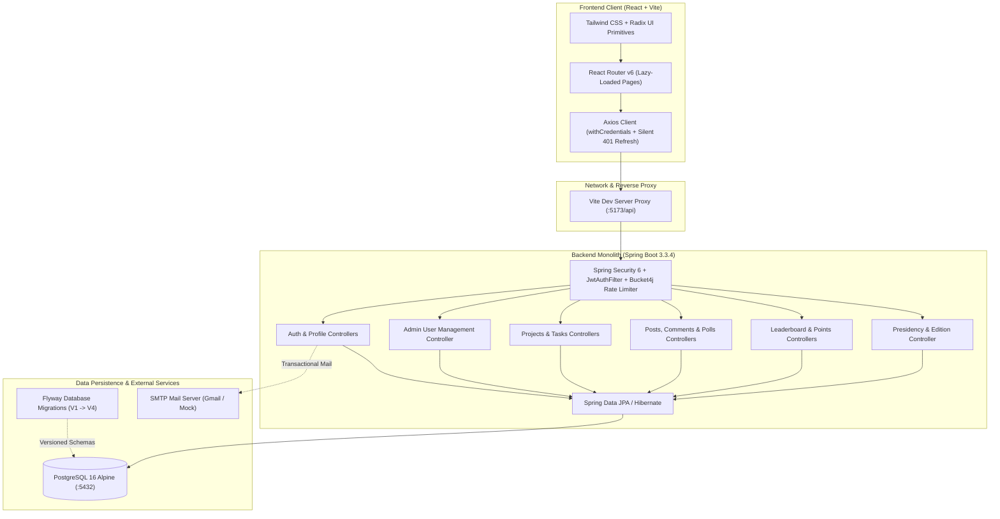

<div align="center">

# 🌿 Wassal Platform — منصة وصال

**The Central Operational & Member Management Platform for Caravane El Hayat**

[](https://openjdk.org/projects/jdk/21/)
[](https://spring.io/projects/spring-boot)
[](https://spring.io/projects/spring-security)
[](https://react.dev/)
[](https://www.typescriptlang.org/)
[](https://vitejs.dev/)
[](https://tailwindcss.com/)
[](https://www.postgresql.org/)
[](https://flywaydb.org/)
[](https://docs.docker.com/compose/)

<br />

*Wassal ("وصال" — Connection / Bond) is the purpose-built internal operations system developed for **Caravane El Hayat** (قافلة الحياة), a Moroccan humanitarian and medical association. It streamlines member onboarding, executive governance, field project execution, volunteer task coordination, gamified engagement, and presidential mandate transitions.*

</div>

---

## 📑 Table of Contents

- [Overview & Mission](#-overview--mission)
- [System Architecture](#-system-architecture)
- [Repository Structure](#-repository-structure)
- [Core Business Modules](#-core-business-modules)
  - [1. Member Lifecycle & User Management](#1-member-lifecycle--user-management)
  - [2. Role-Based Access Control (RBAC)](#2-role-based-access-control-rbac)
  - [3. Projects & Fieldwork Task Management](#3-projects--fieldwork-task-management)
  - [4. Community Feed, Posts & Interactive Polls](#4-community-feed-posts--interactive-polls)
  - [5. Gamified Points & Leaderboard](#5-gamified-points--leaderboard)
  - [6. Caravane Editions & Presidential Handover](#6-caravane-editions--presidential-handover)
- [WASSAL Frontend Design System](#-wassal-frontend-design-system)
- [Quick Start & Local Setup](#-quick-start--local-setup)
- [Pre-Seeded Mock Accounts](#-pre-seeded-mock-accounts)
- [Configuration & Environment Variables](#-configuration--environment-variables)
- [Authentication & Security Architecture](#-authentication--security-architecture)
- [Testing & Quality Assurance](#-testing--quality-assurance)
- [API Documentation & Deep Dives](#-api-documentation--deep-dives)

---

## 🌍 Overview & Mission

**Caravane El Hayat** mobilizes multidisciplinary volunteers, doctors, and logistics teams across Moroccan regions to deliver humanitarian aid, medical caravans, and social programs. 

**Wassal** replaces fragmented spreadsheets and ad-hoc communication channels with an integrated, high-frequency operational workspace:
- **Zero-Friction Volunteer Intake:** Structured self-registration and admin vetting.
- **Hierarchical Governance:** Clear role delineation between Association Executives (President, VP), Human Resources (RH), Team Leaders, and Volunteers.
- **Fieldwork Coordination:** Structured breakdown of projects into discrete tasks and donation collection missions.
- **Fair Participation Tracking:** Members earn points for completed tasks, fostering healthy engagement and reliable field rosters.
- **Institutional Continuity:** Smooth presidential handover workflow with Caravane edition incrementation and historical data archival.

---

## 🏗️ System Architecture



---

## 📂 Repository Structure

The repository is structured as a unified monorepo containing the backend service, frontend client application, and shared design tokens:

```
wassal/
├── backend/                       # Spring Boot 3.3.4 REST API Service
│   ├── src/
│   │   ├── main/
│   │   │   ├── java/com/wassal/
│   │   │   │   ├── usermanagement/        # Auth, Users, Roles, Profile, Security
│   │   │   │   ├── projectmanagement/     # Projects, Tasks, Affiliations, Leaderboard
│   │   │   │   └── posts/                 # Community Feed, Markdown Posts, Polls, Comments
│   │   │   └── resources/
│   │   │       ├── db/migration/          # Flyway SQL migrations (V1 to V4)
│   │   │       ├── db/migration-pg/       # PostgreSQL-specific partial indexes
│   │   │       └── application.yml        # Application configuration & profiles
│   │   └── test/                          # Comprehensive JUnit 5 + MockMvc test suites
│   ├── docker-compose.yml         # Containerized PostgreSQL 16 Alpine setup
│   ├── pom.xml                    # Maven build descriptor (Java 21 LTS)
│   └── README.md                  # Comprehensive Backend & Frontend Integration Guide
│
├── frontend/                      # React 18 / Vite / TypeScript Client Application
│   ├── src/
│   │   ├── api/                   # Axios client instance, endpoints & interceptors
│   │   ├── components/            # Reusable UI components & Radix wrappers
│   │   │   ├── admin/             # Presidential handover & admin controls
│   │   │   ├── common/            # Buttons, Badges, Modals, MarkdownView, Pagination
│   │   │   ├── layout/            # AppLayout, Header, Sidebar, MobileBottomNav
│   │   │   ├── members/           # Member filters, cards, and detail dialogs
│   │   │   ├── posts/             # Feed cards, polls, and comment threads
│   │   │   ├── projects/          # Project creation and summary cards
│   │   │   ├── tasks/             # Task cards, affiliations, and status pills
│   │   │   └── ui/                # Accessible Radix UI + Tailwind primitives
│   │   ├── context/               # AuthContext, ToastContext
│   │   ├── hooks/                 # Custom React hooks (useAuth, useToast, etc.)
│   │   ├── pages/                 # Lazy-loaded routed views
│   │   │   ├── admin/             # Member directory & Pending approvals
│   │   │   ├── auth/              # Login, Register, Forgot & Reset Password
│   │   │   ├── leaderboard/       # Podium & rankings table
│   │   │   ├── posts/             # Feed list & Post detail discussions
│   │   │   ├── profile/           # User profile & credentials self-service
│   │   │   ├── projects/          # Projects list & Project detail dashboard
│   │   │   └── tasks/             # Tasks catalog & Affiliation management
│   │   ├── routes/                # Protected, Public, and AdminRoute guards
│   │   └── types/                 # Shared TypeScript models and API DTO contracts
│   ├── tailwind.config.js         # Wassal brand tokens & typography configuration
│   ├── vite.config.ts             # Vite build optimization, vendor chunking & proxy
│   └── package.json               # NPM dependencies & scripts
│
└── .agents/                       # Agent customization skills & design system guides
    └── skills/
        └── wassal-frontend-design/ # Brand colors, typography, and UX guidelines
```

---

## ⚡ Core Business Modules

### 1. Member Lifecycle & User Management

- **Self-Registration:** New volunteers register with full name, email, Moroccan phone format, and a secure password. Newly created accounts enter `PENDING_APPROVAL` status.
- **Admin Approval / Rejection:**
  - Members in `PENDING_APPROVAL` or `REJECTED` state can be approved by the Admin tier (`PRESIDENT`, `VICE_PRESIDENT`, or `RH`).
  - Rejection notifies the applicant with direct administrative contact info (name, email, phone) for clarification.
- **Member Blocking / Unblocking:** Administrators can immediately revoke access for misconduct or inactive status.
- **Credentials & Self-Service:**
  - Profile self-service to update contact details and change password.
  - Forgot password flow with a time-limited 6-digit code (valid for 10 minutes, max 5 attempts) dispatched via SMTP.

### 2. Role-Based Access Control (RBAC)

The platform enforces strict role boundaries across 5 levels:

$$\text{PRESIDENT} > \text{VICE\_PRESIDENT} > \text{RH} > \text{TEAM\_LEADER} > \text{MEMBER}$$

| Role | User Management | Project Management | Task Creation & Management | Volunteer Affiliation | Feed & Polls |
|---|---|---|---|---|---|
| **PRESIDENT** | Full (Approve, Reject, Block, Assign Roles, Handover) | Full (Create, Edit, Mark Done) | Full (Create, Assign, Confirm Done) | Direct Assign & Approve | Post, Poll, Pin, Moderate |
| **VICE_PRESIDENT** | Full (Except cannot block/reassign President) | Full (Create, Edit, Mark Done) | Full (Create, Assign, Confirm Done) | Direct Assign & Approve | Post, Poll, Pin, Moderate |
| **RH (Human Resources)** | Full (Approve, Reject, Block Members & Leaders) | Read-only (Points masked) | Read-only (Points masked) | Request to join tasks | Post, Poll, Pin, Moderate |
| **TEAM_LEADER** | Read-Only Directory (Search & consult members) | View Projects & Summary | Create Standalone Tasks & Project Tasks | Direct Assign & Approve | Post, Poll, Comment |
| **MEMBER** | None | View Active Projects & Tasks | View Assigned Tasks | Request Affiliation, Mark Done | Post, Poll, Comment, Vote |

> [!IMPORTANT]
> **RH Scope Limitation:** The `RH` role is strictly confined to user administration. `RH` cannot create projects or tasks, and cannot access administrative points metrics for other members.

### 3. Projects & Fieldwork Task Management

- **Humanitarian Projects:** Projects represent major Caravane initiatives (e.g., *Caravane Médicale Atlas 2026*). Projects aggregate multiple fieldwork tasks.
- **Task Types:**
  - `TASK`: General operational, medical, or logistical activities.
  - `COLLECTION`: Targeted donation, material gathering, or fundraising drives.
- **Affiliation Workflow:**
  1. **Request to Join:** Any approved member can request affiliation on an open task.
  2. **Workload Review:** Leaders can see the candidate's current active affiliation count before accepting.
  3. **Direct Assignment:** Leaders can directly search and affiliate approved members.
  4. **Completion Flow:** Active members submit `"Request Done"` $\rightarrow$ The task owner or executive reviews and confirms completion $\rightarrow$ Points are automatically awarded, and all remaining pending requests are pruned.

### 4. Community Feed, Posts & Interactive Polls

- **Rich Announcements:** Formatted with Markdown support, sanitized with DOMPurify.
- **Interactive Multi-Choice Polls:** Created with set expiration timestamps. Members can cast or update votes before the deadline. Closed polls lock voting and present finalized voter percentages.
- **Engagement:** Real-time Upvoting/Downvoting (`LIKE` / `DISLIKE`), nested comments and replies, and Administrator post pinning.

### 5. Gamified Points & Leaderboard

- **Automated Attribution:** Points are granted immediately upon confirmed task completion.
- **Real-Time Leaderboard:** Top 50 ranked members displayed with podium visuals (Gold, Silver, Bronze) and dynamic ranking cards.
- **Data Export:** RFC 4180 UTF-8 CSV exports available for leadership and administration (`/api/leaderboard/export-csv` and `/api/admin/users/export-csv`).

### 6. Caravane Editions & Presidential Handover

- **Edition Tracking:** The platform maintains the active Caravane edition number (`editionNumber`).
- **Graceful Handover ("Danger Zone"):**
  - Only accessible to the current sitting `PRESIDENT`.
  - Atomically reassigns the `PRESIDENT` role to the chosen successor, demoting the outgoing president to `MEMBER`.
  - Increments the edition number and archives all current edition projects, tasks, and posts.

---

## 🎨 WASSAL Frontend Design System

Wassal is built for high-throughput association operations, prioritizing clarity, visual contrast, and high information density over decorative flourishes.

### Official Brand Color Tokens
Source Palette: [coolors.co/53dd6c-63a088-56638a-483a58-56203d](https://coolors.co/53dd6c-63a088-56638a-483a58-56203d)

| Token | Hex | Role | Contrast on White | Usage & Constraints |
|---|---|---|---|---|
| `wassal-green` | `#53DD6C` | Primary brand accent / CTA fill | 1.76:1 | Used as filled button/badge with dark ink (`#1A1A1A` or `#483A58`). Never use as light text on white. |
| `wassal-green-ink`| `#1B872E` | Accessible dark green | 4.6:1 (AA) | Text on white, link color, or filled button surface with white text. |
| `wassal-sage` | `#63A088` | Secondary green | 3.0:1 | Borders, subtle highlights, large text (18px+), icons. |
| `wassal-sage-deep`| `#4B7B68` | Accessible sage variant | 4.85:1 (AA) | Badges and secondary buttons with white text. |
| `wassal-slate` | `#56638A` | Tertiary slate blue | 5.9:1 (AA) | Body copy, secondary headers, links, neutral tags. |
| `wassal-plum` | `#483A58` | Dark neutral plum | 10.4:1 (AAA) | Sidebar/navbar background, headings, primary chrome. |
| `wassal-wine` | `#56203D` | Destructive / critical wine | 12.6:1 (AAA) | Rejections, blocks, deletions, Danger Zone presidential handover. |
| `wassal-bg` | `#FAFAF9` | App canvas background | — | Warm off-white page background. |
| `wassal-surface` | `#FFFFFF` | Card & table surface | — | Pure white card surfaces. |
| `wassal-border` | `#E4E2E8` | Table / card border | — | Slate-tinted crisp border. |

### Typography Pairing
- **Headings:** [Plus Jakarta Sans](https://fonts.google.com/specimen/Plus+Jakarta+Sans) (Weights 600, 700) — modern geometric clarity.
- **Body & UI:** [Inter](https://fonts.google.com/specimen/Inter) (Weights 400, 500, 600) — optimized for high readability and French accent support (é, è, ê, ç, à, œ).

---

## 🚀 Quick Start & Local Setup

### Prerequisites
- **Java 21 LTS** (`openjdk-21-jdk`)
- **Maven 3.8+**
- **Node.js 18+** or **20+** and **npm**
- **Docker & Docker Compose**

### Step 1: Start PostgreSQL
```bash
cd backend
docker compose up -d
```
*PostgreSQL starts on port `5432` with database `wassal_db`, user `wassal_user`, and password `wassal_password`.*

### Step 2: Start the Backend Service
```bash
cd backend
mvn spring-boot:run
```
*The backend starts at `http://localhost:8080`. Flyway automatically runs database migrations (`V1`, `V2`, `V2_1`, `V3`, `V4`), and `DataInitializer` populates test accounts.*

### Step 3: Start the Frontend Client
```bash
cd frontend
npm install
npm run dev
```
*The frontend starts at `http://localhost:5173` with Vite's development proxy forwarding `/api/*` requests to `http://localhost:8080`.*

### Port & Endpoint Summary

| Service | URL | Description |
|---|---|---|
| **Frontend UI** | [http://localhost:5173](http://localhost:5173) | Single Page Application (Vite Dev Server) |
| **Backend API** | [http://localhost:8080](http://localhost:8080) | Spring Boot REST API |
| **Swagger UI** | [http://localhost:8080/swagger-ui/index.html](http://localhost:8080/swagger-ui/index.html) | Interactive OpenAPI documentation & test console |
| **OpenAPI Spec** | [http://localhost:8080/v3/api-docs](http://localhost:8080/v3/api-docs) | Raw OpenAPI v3 JSON schema |
| **PostgreSQL** | `localhost:5432` | Database instance (`wassal_db`) |

---

## 👥 Pre-Seeded Mock Accounts

When running in non-test mode (`wassal.seed-mock-data: true`), `DataInitializer` seeds 8 development accounts.

> [!NOTE]
> **Default Password for All Seed Accounts:** `Password123!`

| Role | Name | Email | Account Status | Notes & Scenarios |
|---|---|---|---|---|
| `PRESIDENT` | Amine Bennani | `president@wassal.org` | `APPROVED` | Full access, Danger Zone presidential handover. |
| `VICE_PRESIDENT` | Sarah Mansouri | `vp@wassal.org` | `APPROVED` | Executive privileges across projects and members. |
| `RH` | Youssef Alami | `rh@wassal.org` | `APPROVED` | Human resources user admin; projects restricted. |
| `TEAM_LEADER` | Fatima Zahra | `teamleader@wassal.org` | `APPROVED` | Project/task creator; consults member directory. |
| `MEMBER` | Mehdi Tahiri | `member@wassal.org` | `APPROVED` | Active volunteer; requests tasks, posts, votes. |
| `MEMBER` | Lina Idrissi | `pending@wassal.org` | `PENDING_APPROVAL` | Used to test pending approval flows. |
| `MEMBER` | Omar Berrada | `rejected@wassal.org` | `REJECTED` | Used to test rejection notice & contact modals. |
| `MEMBER` | Karim Zouhair | `blocked@wassal.org` | `APPROVED` (Blocked) | Used to test blocked access denial flows. |

---

## ⚙️ Configuration & Environment Variables

Key parameters configurable via environment variables in `backend/src/main/resources/application.yml`:

| Environment Variable | Default Value | Description |
|---|---|---|
| `DB_HOST` | `localhost` | PostgreSQL host address |
| `DB_PORT` | `5432` | PostgreSQL port |
| `DB_NAME` | `wassal_db` | Database schema name |
| `DB_USER` | `wassal_user` | Database username |
| `DB_PASSWORD` | `wassal_password` | Database password |
| `JWT_SECRET` | `404E6352...` (256-bit hex) | Secret key for signing HMAC-SHA256 JWTs |
| `MAIL_HOST` | `smtp.gmail.com` | SMTP host for email dispatch |
| `MAIL_PORT` | `587` | SMTP port (STARTTLS) |
| `MAIL_USERNAME` | — | SMTP username / sender account |
| `MAIL_PASSWORD` | — | SMTP app password |
| `MAIL_MOCK_MODE` | `false` | When `true`, logs emails to console instead of sending |
| `SEED_MOCK_DATA` | `true` | Automatically provisions mock users on clean DB |

---

## 🔒 Authentication & Security Architecture

Wassal implements an enterprise session security model:

1. **Short-Lived Access Tokens:** Signed JWT access tokens valid for 15 minutes, held strictly in client memory.
2. **HttpOnly Refresh Cookies:** Refresh tokens stored in a secure cookie scoped to `Path=/api/auth/refresh` with `SameSite=Strict` and a 7-day expiration.
3. **Silent Token Refresh:** Axios interceptors intercept `401 Unauthorized` responses and silently call `POST /api/auth/refresh`, queuing subsequent requests until the token is renewed.
4. **Token-Bucket Rate Limiting:** Powered by Bucket4j, all authentication endpoints (`/api/auth/*`) enforce a strict limit of 10 requests per minute per client IP to mitigate brute-force attacks.

```
+-----------------------------------------------------------------------------------+
|  POST /api/auth/login ---> Returns: { accessToken } + HttpOnly Refresh Cookie     |
|  API Calls (GET/POST) ---> Header: Authorization: Bearer <accessToken>           |
|  On 401 Expiration    ---> POST /api/auth/refresh (Cookie passed automatically)   |
|  POST /api/auth/logout---> Clears HttpOnly Refresh Cookie (Max-Age=0)             |
+-----------------------------------------------------------------------------------+
```

---

## 🧪 Testing & Quality Assurance

### Backend Automated Test Suite
The backend contains 86+ automated tests spanning unit and integration coverage using Spring Boot Test, MockMvc, and an in-memory H2 database:

```bash
cd backend
mvn test
```

Test coverage includes:
- `AuthIntegrationTests`: Registration, rate limiting, token expiration, password resets.
- `AdminUserIntegrationTests`: Member approvals, rejections, role updates, CSV exports.
- `ProjectIntegrationTests`: Project creation, milestone tracking, points masking rules.
- `TaskIntegrationTests`: Affiliation requests, member limits, done confirmations.
- `PostIntegrationTests`: Feed creation, poll voting limits, comments, and post pinning.
- `LeaderboardIntegrationTests`: Points attribution verification and CSV generation.

### Frontend Validation & Production Build
The frontend client enforces full TypeScript type checking and asset optimization:

```bash
cd frontend
# Run TypeScript compilation and production bundle build
npm run build

# Preview production build locally
npm run preview
```

The production bundle uses vendor chunking (`vendor-react`, `vendor-radix`, `vendor-markdown`, `vendor-date`, `vendor-icons`) to ensure sub-second initial page load times and optimal Lighthouse performance.

---

## 📖 API Documentation & Deep Dives

For exhaustive endpoint listings, parameter descriptions, request payloads, and error schemas:

- **Interactive Swagger UI:** Accessible when running the backend at `http://localhost:8080/swagger-ui/index.html`.
- **Backend & Frontend Integration Guide:** Refer to [`backend/README.md`](file:///home/eayzaid/Projects/wassal/backend/README.md) for the complete 1,800+ line specification covering every DTO schema, business rule, and status code.
- **Wassal Design System Guide:** Refer to [`.agents/skills/wassal-frontend-design/SKILL.md`](file:///home/eayzaid/Projects/wassal/.agents/skills/wassal-frontend-design/SKILL.md) for UX and color token details.

---

<div align="center">
  <sub>Developed with ❤️ for Caravane El Hayat (قافلة الحياة)</sub>
</div>
