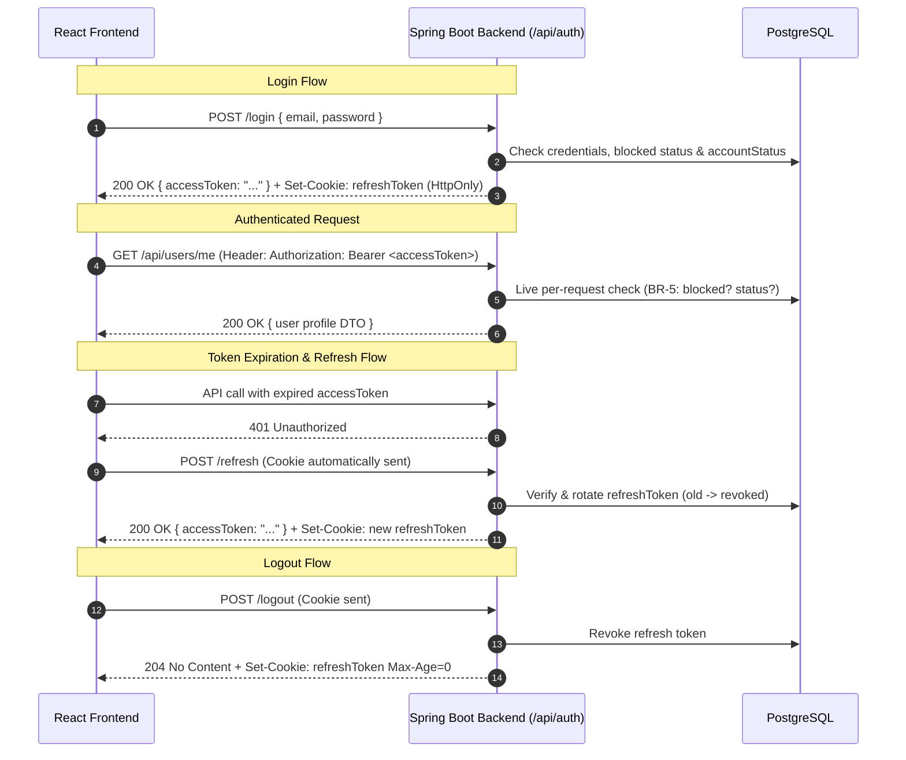

# Wassal Platform — User Management Backend

Production-ready, lean monolithic backend service for the **Wassal Platform (v3 Specification)** built with **Spring Boot 3.3.4**, **Java 21**, **Spring Security 6**, **Spring Data JPA**, and **PostgreSQL**.

This document serves as the complete integration guide for human developers and AI agents building the frontend or integrating with this service.

---

## Table of Contents
1. [Quick Start & Local Setup](#1-quick-start--local-setup)
2. [Frontend Integration Essentials](#2-frontend-integration-essentials)
3. [Authentication & Session Lifecycle](#3-authentication--session-lifecycle)
4. [Roles & Authorization Matrix](#4-roles--authorization-matrix)
5. [Complete API Reference](#5-complete-api-reference)
6. [Error Handling & Response Schemas](#6-error-handling--response-schemas)
7. [Pre-Seeded Mock Accounts](#7-pre-seeded-mock-accounts)
8. [Configuration & Environment Variables](#8-configuration--environment-variables)

---

## 1. Quick Start & Local Setup

### Prerequisites
- **Java 21 LTS**
- **Maven 3.8+**
- **Docker & Docker Compose** (for PostgreSQL)

### Step 1: Start PostgreSQL
```bash
cd backend
docker compose up -d
```
*PostgreSQL will listen on `localhost:5432` with database `wassal_db`, user `wassal_user`, and password `wassal_password`.*

### Step 2: Run the Backend
```bash
mvn spring-boot:run
```
Flyway automatically executes database migrations (`db/migration/V1__init_user_management.sql`), and `DataInitializer` seeds 8 mock user accounts if the database is fresh.

### Step 3: Interactive Documentation
- **Swagger UI:** [http://localhost:8080/swagger-ui/index.html](http://localhost:8080/swagger-ui/index.html)
- **OpenAPI JSON:** [http://localhost:8080/v3/api-docs](http://localhost:8080/v3/api-docs)

---

## 2. Frontend Integration Essentials

### Base URL & Origins
- **Backend Port:** `http://localhost:8080`
- **Allowed Frontend Origins (CORS):**
  - `http://localhost:3000` (Create React App / Vite default)
  - `http://localhost:5173` (Vite alternate default)
  *(Configurable in `application.yml` via `wassal.cors.allowed-origins`).*

### ⚠️ Critical: Credentials & Cookies
The backend uses **HttpOnly cookies** for refresh tokens:
1. **Axios:** You **MUST** set `withCredentials: true`:
   ```javascript
   import axios from 'axios';

   const api = axios.create({
     baseURL: 'http://localhost:8080',
     withCredentials: true, // REQUIRED for the refreshToken cookie
   });
   ```
2. **Fetch API:** You **MUST** specify `credentials: 'include'`:
   ```javascript
   fetch('http://localhost:8080/api/auth/refresh', {
     method: 'POST',
     credentials: 'include'
   });
   ```

### Rate Limiting
- Public authentication endpoints (`/api/auth/*`) are protected by an in-memory token bucket rate limiter (~10 requests per minute per client IP).
- If exceeded, the backend responds with **HTTP 429**:
  ```json
  { "error": "TOO_MANY_REQUESTS", "message": "Too many requests. Please try again later." }
  ```

---

## 3. Authentication & Session Lifecycle



### Access Tokens (JWT)
- **TTL:** 15 minutes.
- **Delivery:** Returned **only in the response body** (`{ "accessToken": "eyJhbG..." }`).
- **Usage:** Store in frontend memory (e.g. React state / auth context) and attach to every request:
  `Authorization: Bearer <accessToken>`.
- **Claims:** `{ sub: "<userId>", role: "<ROLE>", exp: <timestamp>, iat: <timestamp> }`.

### Refresh Tokens
- **TTL:** 7 days.
- **Delivery:** Sent **only as an HttpOnly cookie** scoped specifically to the refresh endpoint:
  `refreshToken=<opaque>; HttpOnly; Secure=<bool>; SameSite=Strict; Path=/api/auth/refresh; Max-Age=604800`
  *Security guarantee:* Because the cookie path is strictly `/api/auth/refresh`, the browser sends this cookie **ONLY** during token refresh requests (`POST /api/auth/refresh`), preventing accidental exposure on all other API calls.
- **Security:** The backend stores only `SHA-256(refreshToken)`. Raw token is never stored in DB.
- **Rotation:** Calling `/api/auth/refresh` immediately revokes the old refresh token row and sets a new cookie.

---

## 4. Roles & Authorization Matrix

### User Roles
- `PRESIDENT`: Top executive. Holds authorities `ROLE_PRESIDENT` and `ROLE_ADMIN`.
- `VICE_PRESIDENT`: Executive. Holds authorities `ROLE_VICE_PRESIDENT` and `ROLE_ADMIN`.
- `RH`: HR administrator. Holds authorities `ROLE_RH` and `ROLE_ADMIN`.
- `TEAM_LEADER`: Non-admin leader. Holds authority `ROLE_TEAM_LEADER`.
- `MEMBER`: Default registered user. Holds authority `ROLE_MEMBER`.

### Account Statuses
- `PENDING_APPROVAL`: Default on registration. Login is blocked.
- `APPROVED`: Active user allowed to authenticate.
- `REJECTED`: Terminal state. Reconsideration is handled out-of-band via admin contact.

### Business Rules for Frontend UI Logic

| Rule | Description | UI Implementation Recommendation |
|---|---|---|
| **BR-1** | Unique Email | Show inline field error on 409 `EMAIL_ALREADY_EXISTS`. |
| **BR-2** | Registration Default | Always creates `MEMBER` in `PENDING_APPROVAL`. Inform user to await admin approval. |
| **BR-3** | Login Pending | Returns 403 `ACCOUNT_PENDING_APPROVAL`. Show "Awaiting Approval" banner. |
| **BR-4** | Login Rejected | Returns 403 `ACCOUNT_REJECTED` with `contact: { name, email, phone }`. Render contact card for reconsideration. |
| **BR-5** | Live Block Check | Checked in DB on **every request**. If blocked, returns 403 `ACCOUNT_BLOCKED` with `contact`. Redirect to blocked screen. |
| **BR-6** | `TEAM_LEADER` reachability | Can **only** be assigned to existing users whose current role is `MEMBER`. Hide or disable this option for other roles. |
| **BR-7** | Admin Directory | Only accessible to `PRESIDENT`, `VICE_PRESIDENT`, `RH` (`ROLE_ADMIN`). Hide Admin nav link for Members/Team Leaders. |
| **BR-8** | No Self-Actions | An admin cannot approve, reject, block, unblock, or change role on **themself**. Disable action buttons for the current user's own row. |
| **BR-9** | Top Tier Protection | If target user is `PRESIDENT` or `VICE_PRESIDENT`, **only an actor with role `PRESIDENT`** can block, unblock, or change role. Hide/disable actions if current user is not `PRESIDENT`. |
| **BR-10** | Reopening Rejected Users & Status Invariance | A `REJECTED` user can be accepted/approved again via `/api/admin/users/{id}/approve`. However, **once accepted/approved (`APPROVED`), a user cannot be rejected again**; governance on active members is restricted to blocking (`/block`), unblocking (`/unblock`), or role change. |
| **BR-11** | Self-Service Scope | User can only update `firstName`, `lastName`, and `phoneNumber`. `email`, `role`, and `status` are read-only. |
| **BR-12** | Password Reset Limit | 6-digit code expires in 10 minutes and is invalidated after 5 failed attempts. |
| **BR-13** | RH Assignment Limit | `RH` **cannot** assign `PRESIDENT`, `VICE_PRESIDENT`, or `RH` roles. Filter out these options from role dropdown if actor is `RH`. |
| **BR-14** | Single President & Mandatory Handover | Only the active `PRESIDENT` can assign the `PRESIDENT` role to an active member. Because **only one president is allowed in the whole application**, this action automatically strips the current president of their title, demoting them to `MEMBER`. Non-presidents attempting to assign `PRESIDENT` receive 403 `INSUFFICIENT_PRIVILEGE`. |

---

## 5. Complete API Reference

### 5.1 Public Auth Endpoints (`/api/auth`)

#### `POST /api/auth/register`
- **Request Body:**
  ```json
  {
    "firstName": "John",
    "lastName": "Doe",
    "email": "john.doe@example.com",
    "phoneNumber": "+212600000000",
    "password": "Password123!"
  }
  ```
- **Success Response:** `201 Created`
  ```json
  {
    "id": 1,
    "firstName": "John",
    "lastName": "Doe",
    "email": "john.doe@example.com",
    "phoneNumber": "+212600000000",
    "role": "MEMBER",
    "accountStatus": "PENDING_APPROVAL",
    "blocked": false,
    "createdAt": "2026-09-12T16:00:00Z"
  }
  ```
- **Errors:** `400 Validation Error`, `409 EMAIL_ALREADY_EXISTS`.

#### `POST /api/auth/login`
- **Request Body:**
  ```json
  {
    "email": "member@wassal.org",
    "password": "Password123!"
  }
  ```
- **Success Response:** `200 OK`
  - Body: `{ "accessToken": "eyJhbGciOiJIUzI1NiJ9..." }`
  - Header: `Set-Cookie: refreshToken=...; HttpOnly; SameSite=Strict; Path=/api/auth/refresh; Max-Age=604800`
- **Errors:**
  - `401 INVALID_CREDENTIALS`
  - `403 ACCOUNT_PENDING_APPROVAL`
  - `403 ACCOUNT_REJECTED` (contains `contact` object)
  - `403 ACCOUNT_BLOCKED` (contains `contact` object)

#### `POST /api/auth/refresh`
- **Request:** Empty body. Browser automatically passes the `refreshToken` cookie (scoped strictly to `Path=/api/auth/refresh`).
- **Success Response:** `200 OK`
  - Body: `{ "accessToken": "..." }`
  - Header: Rotated `Set-Cookie: refreshToken=...; Path=/api/auth/refresh; ...`
- **Errors:** `400` or `401 INVALID_TOKEN`.

#### `POST /api/auth/logout`
- **Request:** Optional Bearer token or `refreshToken` cookie.
- **Success Response:** `204 No Content`
  - Header: `Set-Cookie: refreshToken=; Max-Age=0; Path=/api/auth/refresh`
  - Revokes active refresh token(s) and clears cookie.

#### `POST /api/auth/forgot-password`
- **Request Body:** `{ "email": "user@example.com" }`
- **Success Response:** `200 OK`
  ```json
  { "message": "If this email is registered, a password reset code has been sent." }
  ```
  *(Always returns 200 to prevent user enumeration).*

#### `POST /api/auth/verify-reset-code`
- **Request Body:** `{ "email": "user@example.com", "code": "123456" }`
- **Success Response:** `200 OK`
  ```json
  { "resetToken": "b4b84080-6927-46fe-8fae-9d261e469502" }
  ```
- **Errors:** `400 INVALID_OPERATION` (Invalid code, expired code, or attempt limit exceeded).

#### `POST /api/auth/reset-password`
- **Request Body:** `{ "resetToken": "b4b84080-...", "newPassword": "NewPassword123!" }`
- **Success Response:** `200 OK`
  ```json
  { "message": "Password has been successfully reset." }
  ```

---

### 5.2 Admin Endpoints (`/api/admin/users`)
*Requires `Authorization: Bearer <token>` of an account with `ROLE_ADMIN` (`PRESIDENT`, `VICE_PRESIDENT`, `RH`).*

#### `GET /api/admin/users`
Paginated search & filtering directory.
- **Query Parameters:**
  - `status`: `PENDING_APPROVAL` | `APPROVED` | `REJECTED`
  - `role`: `PRESIDENT` | `VICE_PRESIDENT` | `RH` | `TEAM_LEADER` | `MEMBER`
  - `blocked`: `true` | `false`
  - `q`: Search string (searches `firstName`, `lastName`, and `email`, case-insensitive)
  - `page`: Page index (default `0`)
  - `size`: Page size (default `20`)
  - `sort`: Sorting criteria (e.g. `createdAt,desc`)
- **Success Response:** `200 OK` (Spring Data Page DTO)
  ```json
  {
    "content": [
      {
        "id": 1,
        "firstName": "Mehdi",
        "lastName": "Tahiri",
        "email": "member@wassal.org",
        "phoneNumber": "+212600000005",
        "role": "MEMBER",
        "accountStatus": "APPROVED",
        "blocked": false,
        "createdAt": "2026-09-12T16:00:00Z"
      }
    ],
    "page": {
      "size": 20,
      "number": 0,
      "totalElements": 1,
      "totalPages": 1
    }
  }
  ```

#### `GET /api/admin/users/{id}`
- **Success Response:** `200 OK` with `UserSummaryDto`.

#### `PATCH /api/admin/users/{id}/approve`
- **Precondition:** User status must be `PENDING_APPROVAL` or `REJECTED`. Target cannot be actor (BR-8).
- Accepts / approves the user (sets status $\rightarrow$ `APPROVED`) and dispatches confirmation email with login link.
- **Success Response:** `200 OK` with updated `UserSummaryDto`.

#### `PATCH /api/admin/users/{id}/reject`
- **Precondition:** User status must be `PENDING_APPROVAL`. Target cannot be actor (BR-8).
- Sets status `REJECTED` and dispatches email with admin contact info.
- **Constraint:** Once a user is accepted/approved (`APPROVED`), they **cannot** be rejected again (returns 400 `INVALID_OPERATION`). To restrict an active member, use the `/block` endpoint instead.
- **Success Response:** `200 OK` with updated `UserSummaryDto`.

#### `PATCH /api/admin/users/{id}/role`
- **Request Body:** `{ "role": "PRESIDENT" }`
- **Constraints:**
  - Cannot change self-role (BR-8).
  - Target `PRESIDENT` or `VICE_PRESIDENT` $\rightarrow$ Actor must be `PRESIDENT` (BR-9).
  - Actor `RH` cannot assign `PRESIDENT`, `VICE_PRESIDENT`, or `RH` (BR-13).
  - Setting `TEAM_LEADER` requires target's current role to be `MEMBER` (BR-6).
  - **Single President Rule (BR-14):** Setting `PRESIDENT` requires actor to be `PRESIDENT` and target to be an approved, unblocked user. This action **strips the current president of their role** (demotes them to `MEMBER`), ensuring strictly one President exists across the entire application.
- **Success Response:** `200 OK` with updated `UserSummaryDto`.

#### `PATCH /api/admin/users/{id}/block`
- **Constraints:** Cannot block self (BR-8). Target `PRESIDENT` or `VICE_PRESIDENT` requires actor `PRESIDENT` (BR-9).
- Immediately revokes all active refresh tokens for this user.
- **Success Response:** `200 OK` with updated `UserSummaryDto`.

#### `PATCH /api/admin/users/{id}/unblock`
- **Constraints:** Cannot unblock self (BR-8). Target `PRESIDENT` or `VICE_PRESIDENT` requires actor `PRESIDENT` (BR-9).
- **Success Response:** `200 OK` with updated `UserSummaryDto`.

---

### 5.3 Self-Service Endpoints (`/api/users/me`)
*Requires `Authorization: Bearer <token>` of any authenticated unblocked user.*

#### `GET /api/users/me`
- **Success Response:** `200 OK` with current user's `UserSummaryDto`.

#### `PUT /api/users/me`
- Update editable profile fields (BR-11).
- **Request Body:**
  ```json
  {
    "firstName": "Mehdi",
    "lastName": "Tahiri",
    "phoneNumber": "+212699999999"
  }
  ```
- **Success Response:** `200 OK` with updated `UserSummaryDto`.

#### `PUT /api/users/me/password`
- **Request Body:**
  ```json
  {
    "currentPassword": "Password123!",
    "newPassword": "NewSecurePassword123!"
  }
  ```
- **Success Response:** `200 OK` `{ "message": "Password updated successfully." }`
- **Errors:** `401 INVALID_CREDENTIALS` if `currentPassword` does not match.

---

## 6. Error Handling & Response Schemas

All exceptions are intercepted by a centralized `@RestControllerAdvice` and return the following exact JSON schemas.

### 1. Account Pending Approval (`HTTP 403`)
```json
{
  "error": "ACCOUNT_PENDING_APPROVAL",
  "message": "Your account is awaiting admin approval."
}
```

### 2. Account Rejected (`HTTP 403` with contact block)
```json
{
  "error": "ACCOUNT_REJECTED",
  "message": "Your registration was rejected. Contact an administrator to request reconsideration.",
  "contact": {
    "name": "Amine Bennani",
    "email": "president@wassal.org",
    "phone": "+212600000001"
  }
}
```

### 3. Account Blocked (`HTTP 403` with contact block)
```json
{
  "error": "ACCOUNT_BLOCKED",
  "message": "Your account has been blocked. Contact an administrator.",
  "contact": {
    "name": "Amine Bennani",
    "email": "president@wassal.org",
    "phone": "+212600000001"
  }
}
```

### 4. Invalid Credentials (`HTTP 401`)
```json
{
  "error": "INVALID_CREDENTIALS",
  "message": "Incorrect email or password."
}
```

### 5. Insufficient Hierarchy Privilege (`HTTP 403`)
*Triggered on BR-9 or BR-13 violations:*
```json
{
  "error": "INSUFFICIENT_PRIVILEGE",
  "message": "Only the President can perform this action on this user."
}
```

### 6. Email Already Registered (`HTTP 409`)
```json
{
  "error": "EMAIL_ALREADY_EXISTS",
  "message": "An account with this email already exists."
}
```

### 7. Bean Validation Error (`HTTP 400`)
```json
{
  "error": "VALIDATION_ERROR",
  "message": "Password must be at least 8 characters long; Invalid email format"
}
```

### 8. Invalid Business Operation (`HTTP 400`)
```json
{
  "error": "INVALID_OPERATION",
  "message": "Only accounts with PENDING_APPROVAL status can be approved."
}
```

---

## 7. Pre-Seeded Mock Accounts

When the application starts with an empty database, the following 8 test accounts are automatically seeded.

> 🔑 **All mock accounts share the default password:** `Password123!`

| Email | Role | Status | Blocked | Testing Scenario |
|---|---|---|---|---|
| `president@wassal.org` | `PRESIDENT` | `APPROVED` | `false` | Top executive holding full admin privilege over VP, RH, and Members (BR-9). |
| `vp@wassal.org` | `VICE_PRESIDENT` | `APPROVED` | `false` | Executive admin. Cannot modify President (BR-9). |
| `rh@wassal.org` | `RH` | `APPROVED` | `false` | HR admin. Cannot modify President/VP (BR-9) or assign top roles (BR-13). |
| `teamleader@wassal.org` | `TEAM_LEADER` | `APPROVED` | `false` | Non-admin team leader. |
| `member@wassal.org` | `MEMBER` | `APPROVED` | `false` | Standard approved member. Can test self-profile and password update. |
| `pending@wassal.org` | `MEMBER` | `PENDING_APPROVAL` | `false` | Test BR-3 login rejection and admin approval/rejection workflows. |
| `rejected@wassal.org` | `MEMBER` | `REJECTED` | `false` | Test BR-4 login rejection with President contact block. |
| `blocked@wassal.org` | `MEMBER` | `APPROVED` | `true` | Test BR-5 login & per-request live token rejection. |

---

## 8. Configuration & Environment Variables

Key properties in [`application.yml`](src/main/resources/application.yml) can be overridden via environment variables:

| Variable | Default Value | Description |
|---|---|---|
| `DB_HOST` | `localhost` | PostgreSQL host |
| `DB_PORT` | `5432` | PostgreSQL port |
| `DB_NAME` | `wassal_db` | PostgreSQL database name |
| `DB_USER` | `wassal_user` | PostgreSQL username |
| `DB_PASSWORD` | `wassal_password` | PostgreSQL password |
| `JWT_SECRET` | *(256-bit default)* | HMAC-SHA256 signing key (min 32 bytes) |
| `MAIL_HOST` | `smtp.gmail.com` | SMTP host |
| `MAIL_PORT` | `587` | SMTP port (STARTTLS) |
| `MAIL_USERNAME` | `zaidaneayman738@gmail.com` | SMTP username |
| `MAIL_PASSWORD` | *(Configured Google App Password)* | SMTP password |
| `MAIL_FROM` | `zaidaneayman738@gmail.com` | From header on outgoing emails |
| `MAIL_MOCK_MODE` | `false` | Set to `true` to log emails to console instead of sending |
| `SEED_MOCK_DATA` | `true` | Set to `false` to skip initial mock user seeding |
| `LOGIN_URL` | `http://localhost:3000/login` | Login URL included in approval emails |
