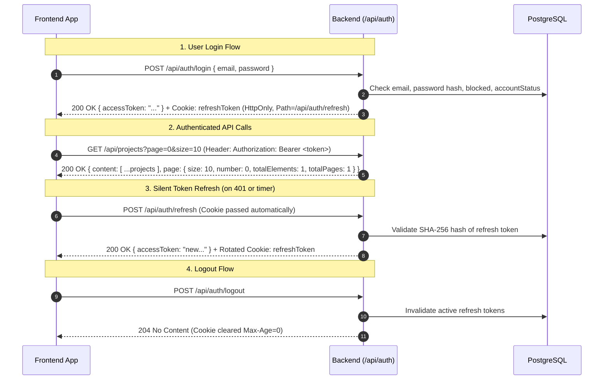

# Wassal Platform — Backend & Frontend Integration Guide

Production-ready, lean monolithic backend service for the **Wassal Platform** built with **Spring Boot 3.3.4**, **Java 21**, **Spring Security 6**, **Spring Data JPA**, and **PostgreSQL**.

This document serves as the **exhaustive, single source of truth** for human frontend engineers and autonomous AI agents building the client application (React / Vite / TypeScript / Tailwind CSS).

---

## Table of Contents
1. [Quick Start & Local Setup](#1-quick-start--local-setup)
2. [Frontend Integration Essentials](#2-frontend-integration-essentials)
3. [WASSAL Frontend Design System & UI Styling](#3-wassal-frontend-design-system--ui-styling)
4. [Authentication & Session Lifecycle](#4-authentication--session-lifecycle)
5. [Roles, Permissions & UI Conditional Rendering Matrix](#5-roles-permissions--ui-conditional-rendering-matrix)
6. [TypeScript Type Definitions](#6-typescript-type-definitions)
7. [User Management API Reference](#7-user-management-api-reference)
8. [Projects & Tasks API Reference](#8-projects--tasks-api-reference)
9. [Posts, Comments & Polls API Reference](#9-posts-comments--polls-api-reference)
10. [Error Handling & Exact JSON Error Schemas](#10-error-handling--exact-json-error-schemas)
11. [Pre-Seeded Mock Test Accounts](#11-pre-seeded-mock-test-accounts)
12. [Configuration & Environment Variables](#12-configuration--environment-variables)

---

## 1. Quick Start & Local Setup

### Prerequisites
- **Java 21 LTS**
- **Maven 3.8+**
- **Docker & Docker Compose** (for PostgreSQL)

### Step 1: Start PostgreSQL
```bash
cd backend
docker compose up -d
```
*PostgreSQL will listen on `localhost:5432` with database `wassal_db`, user `wassal_user`, and password `wassal_password`.*

### Step 2: Run the Backend
```bash
mvn spring-boot:run
```
Flyway automatically applies database migrations (`V1`, `V2`, `V2_1`), and `DataInitializer` provisions 8 initial test user accounts if the database is clean.

### Step 3: Interactive Documentation
- **Swagger UI:** [http://localhost:8080/swagger-ui/index.html](http://localhost:8080/swagger-ui/index.html)
- **OpenAPI JSON:** [http://localhost:8080/v3/api-docs](http://localhost:8080/v3/api-docs)

---

## 2. Frontend Integration Essentials

### Base URL & Allowed Origins
- **Backend API Base:** `http://localhost:8080`
- **Whitelisted CORS Origins:**
  - Configured with `allowedOriginPatterns("*")` to support **any origin** (development, preview ports, local IP addresses, custom domains) while safely preserving credential & cookie sharing (`Access-Control-Allow-Credentials: true`).

### ⚠️ Critical: Credentials & Cookie Scoping
The backend uses **HttpOnly, SameSite=Strict** cookies for refresh tokens, strictly scoped to `Path=/api/auth/refresh`:
1. **Axios Client Setup (Production-Ready Interceptor):**
```typescript
import axios from 'axios';

export const api = axios.create({
  baseURL: 'http://localhost:8080',
  withCredentials: true, // REQUIRED: Transmits and stores HttpOnly refreshToken cookie
  headers: {
    'Content-Type': 'application/json',
  },
});

// In-memory token storage (Do NOT store JWT access token in localStorage for security)
let accessToken: string | null = null;

export const setAccessToken = (token: string | null) => {
  accessToken = token;
};

export const getAccessToken = () => accessToken;

// Request interceptor: Attach bearer token
api.interceptors.request.use((config) => {
  if (accessToken && !config.headers.Authorization) {
    config.headers.Authorization = `Bearer ${accessToken}`;
  }
  return config;
});

// Response interceptor: Automatic silent refresh on 401
let isRefreshing = false;
let failedQueue: Array<{ resolve: (token: string) => void; reject: (err: any) => void }> = [];

const processQueue = (error: any, token: string | null = null) => {
  failedQueue.forEach((prom) => {
    if (error) {
      prom.reject(error);
    } else if (token) {
      prom.resolve(token);
    }
  });
  failedQueue = [];
};

api.interceptors.response.use(
  (response) => response,
  async (error) => {
    const originalRequest = error.config;

    // Do not attempt refresh on login or refresh endpoint failures
    if (
      error.response?.status === 401 &&
      !originalRequest._retry &&
      !originalRequest.url?.includes('/api/auth/login') &&
      !originalRequest.url?.includes('/api/auth/refresh')
    ) {
      if (isRefreshing) {
        return new Promise((resolve, reject) => {
          failedQueue.push({ resolve, reject });
        })
          .then((token) => {
            originalRequest.headers.Authorization = `Bearer ${token}`;
            return api(originalRequest);
          })
          .catch((err) => Promise.reject(err));
      }

      originalRequest._retry = true;
      isRefreshing = true;

      try {
        const { data } = await api.post<{ accessToken: string }>('/api/auth/refresh');
        setAccessToken(data.accessToken);
        processQueue(null, data.accessToken);
        originalRequest.headers.Authorization = `Bearer ${data.accessToken}`;
        return api(originalRequest);
      } catch (refreshError) {
        processQueue(refreshError, null);
        setAccessToken(null);
        window.location.href = '/login';
        return Promise.reject(refreshError);
      } finally {
        isRefreshing = false;
      }
    }

    return Promise.reject(error);
  }
);
```

### Rate Limiting (Token Bucket)
- All public authentication endpoints (`/api/auth/*`) allow **10 requests per minute** per client IP.
- When exceeded, backend returns **HTTP 429**:
  ```json
  { "error": "TOO_MANY_REQUESTS", "message": "Too many requests. Please try again later." }
  ```

---

## 3. WASSAL Frontend Design System & UI Styling

WASSAL is built for **Caravane El Hayat**, a humanitarian association managing members, projects, and fieldwork. It is a dense, high-frequency operational workspace, not a marketing page. Prioritize **clarity, scanning speed, and contrast**.

### Official Brand Color Tokens
Source palette: [coolors.co/53dd6c-63a088-56638a-483a58-56203d](https://coolors.co/53dd6c-63a088-56638a-483a58-56203d)

| Token | Hex | Role | Contrast on White | Usage & Constraints |
|---|---|---|---|---|
| `wassal-green` | `#53DD6C` | Primary brand accent / CTA fill | 1.76:1 | **Never** use as text on white, or white text on it. Use as filled button/badge with dark text (`#1A1A1A` or `#483A58`). |
| `wassal-green-ink`| `#1B872E` | Accessible dark green | 4.6:1 (AA) | Text on white, link color, or filled button surface with white text. |
| `wassal-sage` | `#63A088` | Secondary green | 3.0:1 | Borders, subtle highlights, large text (18px+), icons. |
| `wassal-sage-deep`| `#4B7B68` | Accessible sage variant | 4.85:1 (AA) | Badges, secondary buttons with small white text. |
| `wassal-slate` | `#56638A` | Tertiary slate blue | 5.9:1 (AA) | Body copy, secondary headers, links, muted tags. |
| `wassal-plum` | `#483A58` | Dark neutral plum | 10.4:1 (AAA) | Sidebar/Navbar background, high-contrast headings, main chrome. |
| `wassal-wine` | `#56203D` | Destructive / critical wine | 12.6:1 (AAA) | Block, reject, delete, Danger Zone presidential transfer. |
| `wassal-bg` | `#FAFAF9` | App canvas background | — | Warm off-white page background. |
| `wassal-surface` | `#FFFFFF` | Card & table surface | — | Pure white card surfaces. |
| `wassal-border` | `#E4E2E8` | Table / card border | — | Subtle slate-tinted light border. |

### Tailwind CSS Configuration (`tailwind.config.js`)
```javascript
/** @type {import('tailwindcss').Config} */
module.exports = {
  content: ['./index.html', './src/**/*.{js,ts,jsx,tsx}'],
  theme: {
    extend: {
      colors: {
        wassal: {
          green: '#53DD6C',
          'green-ink': '#1B872E',
          sage: '#63A088',
          'sage-deep': '#4B7B68',
          slate: '#56638A',
          plum: '#483A58',
          wine: '#56203D',
          bg: '#FAFAF9',
          surface: '#FFFFFF',
          border: '#E4E2E8',
        },
      },
      fontFamily: {
        heading: ['"Plus Jakarta Sans"', 'system-ui', 'sans-serif'],
        body: ['Inter', 'system-ui', 'sans-serif'],
      },
    },
  },
  plugins: [],
};
```

### Typography Pairing
- **Headings:** Plus Jakarta Sans (Weights 600, 700)
- **Body & Controls:** Inter (Weights 400, 500, 600) — excellent legibility for French accents (é, è, ê, ç, à, œ).

```html
<link rel="preconnect" href="https://fonts.googleapis.com">
<link href="https://fonts.googleapis.com/css2?family=Plus+Jakarta+Sans:wght@600;700&family=Inter:wght@400;500;600&display=swap" rel="stylesheet">
```

### UI Badge Styling Matrix

| Status / Role | Background Class | Text Class | Border Class |
|---|---|---|---|
| `PENDING_APPROVAL` | `bg-slate-100` | `text-wassal-slate` | `border-wassal-slate/30` |
| `APPROVED` (Active) | `bg-green-50` | `text-wassal-green-ink font-semibold` | `border-wassal-green-ink/30` |
| `REJECTED` | `bg-stone-100` | `text-wassal-plum` | `border-wassal-plum/30` |
| `BLOCKED` | `bg-red-50` | `text-wassal-wine font-semibold` | `border-wassal-wine/30` |
| Task `UNAFFECTED` | `bg-gray-100` | `text-gray-700` | `border-gray-300` |
| Task `PENDING` | `bg-blue-50` | `text-wassal-slate font-medium` | `border-wassal-slate/30` |
| Task `PENDING_CONFIRMATION` | `bg-amber-50` | `text-amber-800 font-semibold` | `border-amber-400` |
| Task `DONE` | `bg-emerald-50` | `text-wassal-green-ink font-bold` | `border-wassal-green-ink/30` |

### Button Styling Guidelines
- **Primary Action (e.g. "Create Project", "Approve Request"):**
  `bg-wassal-green text-wassal-plum font-semibold hover:opacity-90 transition shadow-sm`
- **Secondary Action (e.g. "Add Task", "Save Profile"):**
  `bg-wassal-green-ink text-white font-medium hover:bg-wassal-green-ink/90 transition`
- **Outline / Ghost Action:**
  `border border-wassal-slate text-wassal-slate hover:bg-wassal-slate/10 transition`
- **Destructive Action (e.g. "Reject", "Block User", "Delete Task", "Handover Presidency"):**
  `bg-wassal-wine text-white font-medium hover:bg-wassal-wine/90 transition shadow-sm`

---

## 4. Authentication & Session Lifecycle



---

## 5. Roles, Permissions & UI Conditional Rendering Matrix

The backend enforces five hierarchical roles:
`PRESIDENT` > `VICE_PRESIDENT` > `RH` > `TEAM_LEADER` > `MEMBER`.

### Tier Separation: User Management vs. Project Management
> [!IMPORTANT]
> **Key Security Boundary for Frontend Implementation:**
> - **User Management Admin-Tier:** `PRESIDENT`, `VICE_PRESIDENT`, and `RH`. All three manage user approvals, rejections, member blocking/unblocking, and the member directory.
> - **Project Management Executive Admins:** `PRESIDENT` and `VICE_PRESIDENT` ONLY.
> - **Project & Task Creation:** `PRESIDENT`, `VICE_PRESIDENT`, and `TEAM_LEADER` ONLY.
> - **RH Scope Limitation:** The `RH` role is strictly confined to user management. **`RH` CANNOT create projects (`POST /api/projects`), cannot create standalone tasks (`POST /api/tasks`), and cannot create tasks under projects (`POST /api/projects/{id}/tasks`)** (all return `403 INSUFFICIENT_PRIVILEGE`). In the Projects & Tasks module, `RH` has member-level visibility (unaffiliated task/project points are masked, and RH has no administrative override over projects or tasks).

### Action Visibility & Permission Matrix

| Screen / Component | Target / Action | Required Role / Ownership | Backend Rule | Notes for UI |
|---|---|---|---|---|
| **Directory** | View Users Directory & Consultation | Admin-Tier (`PRESIDENT`, `VP`, `RH`) & `TEAM_LEADER` | `GET /api/admin/users` | Accessible to Team Leaders to search and choose members for task affiliations. Hide directory link only from regular `MEMBER`. |
| **Directory** | View User Directory Counts Summary | Admin-Tier (`PRESIDENT`, `VP`, `RH`) & `TEAM_LEADER` | `GET /api/admin/users/summary` | Returns total, active/approved, pending, rejected, and blocked counts in 1 call for UI cards. |
| **Directory** | View User Details | Admin-Tier (`PRESIDENT`, `VP`, `RH`) & `TEAM_LEADER` | `GET /api/admin/users/{id}` | Accessible to Team Leaders to inspect member details. Hide from regular `MEMBER`. |
| **Directory** | Approve Pending User | User Admin-Tier (`PRESIDENT`, `VP`, `RH`) | BR-8 (not self) | Only show if `accountStatus == 'PENDING_APPROVAL'` or `'REJECTED'`. Forbidden for `TEAM_LEADER`. |
| **Directory** | Reject User | User Admin-Tier (`PRESIDENT`, `VP`, `RH`) | BR-8, BR-10 | **Disable/hide if user is already `APPROVED`**. Forbidden for `TEAM_LEADER`. |
| **Directory** | Block Active User | User Admin-Tier (`PRESIDENT`, `VP`, `RH`) | BR-8, BR-9 | If target is President/VP, **only President can block**. Forbidden for `TEAM_LEADER`. |
| **Directory** | Unblock User | User Admin-Tier (`PRESIDENT`, `VP`, `RH`) | BR-8, BR-9 | If target is President/VP, **only President can unblock**. Forbidden for `TEAM_LEADER`. |
| **Directory** | Change Role Dropdown | User Admin-Tier (`PRESIDENT`, `VP`, `RH`) | BR-6, BR-9, BR-13, BR-14 | • Target `MEMBER` $\leftrightarrow$ `TEAM_LEADER`<br>• `RH` cannot pick President, VP, or RH<br>• Only `PRESIDENT` can assign `PRESIDENT` (strips current)<br>• Forbidden for `TEAM_LEADER` |
| **Projects** | Create Project Button | `PRESIDENT`, `VICE_PRESIDENT`, or `TEAM_LEADER` | FR-T1, BR-T1 | **Hide button for `MEMBER` and `RH`.** If called by `RH`, backend rejects with `403 INSUFFICIENT_PRIVILEGE`. |
| **Projects** | View Project Counts Summary | Any authenticated user | `GET /api/projects/summary` | Returns counts for `all`, `active`, and `done` in 1 call for UI tab counters. |
| **Projects** | View Project Points | Project Owner, `PRESIDENT`, or `VICE_PRESIDENT` | BR-T14 | Mask `totalPoints`, `pointsGained`, `successPercentage` for `MEMBER` and `RH` (and non-owner `TEAM_LEADER`). |
| **Projects** | Add Task under Project | Project Owner, `PRESIDENT`, or `VICE_PRESIDENT` | BR-T2 | Hide button if project `status == 'DONE'`, or if user is `MEMBER` or `RH`. |
| **Projects** | "Mark Project as Done" | Project Owner, `PRESIDENT`, or `VICE_PRESIDENT` | BR-T15 | **Disable button unless all tasks under project have status `DONE`**. Forbidden for `RH` & `MEMBER`. |
| **Tasks** | View My Tasks | Any authenticated user | `GET /api/tasks/my-tasks` | Retrieves caller's created or affiliated tasks with optional `type=COLLECTION\|TASK` filter. |
| **Tasks** | View Task Counts Summary | Any authenticated user | `GET /api/tasks/summary` | Returns counts for `all`, `myTasks`, `pending`, and `done` in 1 call for UI tab counters. |
| **Tasks** | Create Standalone Task | `PRESIDENT`, `VICE_PRESIDENT`, or `TEAM_LEADER` | FR-T3, BR-T1 | Standalone creation modal. **Hide button for `MEMBER` and `RH`.** If called by `RH`, backend rejects with `403 INSUFFICIENT_PRIVILEGE`. |
| **Tasks** | View Task Points | Task/Project Owner, `PRESIDENT`, `VICE_PRESIDENT`, or active member | BR-T14 | In public cards, points badge is hidden for regular members and `RH`. |
| **Tasks** | Delete Task | Task/Project Owner, `PRESIDENT`, or `VICE_PRESIDENT` | BR-T4 | **Disable/hide button if task status is `DONE`**. Forbidden for `RH` & `MEMBER`. |
| **Tasks** | "Join Task" (Affiliation Request)| Any Member (including `RH`) | FR-T7, BR-T13 | Enforces 1 active affiliation and 1 pending request per task. Hide if task status is `DONE`. |
| **Tasks** | Review Requests Modal | Task/Project Owner, `PRESIDENT`, or `VICE_PRESIDENT` | FR-T8, BR-T19 | Shows `requesterActiveAffiliationCount` to flag high workload. Auto-cleans requests on task done. |
| **Tasks** | Direct Assign Member | Task/Project Owner, `PRESIDENT`, or `VICE_PRESIDENT` | FR-T10, BR-T12 | Modal with searchable approved member picker. |
| **Tasks** | Remove Affiliated Member | Task/Project Owner, `PRESIDENT`, or `VICE_PRESIDENT` | BR-T11 | **Disable button if task status is `DONE`**. |
| **Tasks** | "Request Done" Button | Active Affiliated Member | BR-T8, BR-T9 | Only show for members in `activeMembers` when status is `PENDING`. |
| **Tasks** | Confirm / Reject Done | Task/Project Owner, `PRESIDENT`, or `VICE_PRESIDENT` | BR-T8, BR-T10 | Rendered only when task is `PENDING_CONFIRMATION`. On confirm-done, automatically deletes all task affiliation requests. |
| **Points** | View User Points Summary | Self (`callerId == id`), `PRESIDENT`, or `VICE_PRESIDENT` | BR-T16 | `GET /api/users/{id}/points-summary`. Forbidden for `RH` viewing other members. |
| **Danger Zone** | Presidential Handover | `PRESIDENT` only | BR-T17, BR-T18 | Render inside a red-bordered critical modal with confirm dialog. Automatically strips current president role and increments Caravane edition. |
| **Posts** | Create Post (`REGULAR` or `POLL`) | Any authenticated user | FR-P1, BR-P1, BR-P2 | Poll posts require `pollCloseDate > now()` and $\ge 2$ options. |
| **Posts** | Browse Feed (`sort=new\|top`) | Any authenticated user | FR-P2 | Paginated. Supports `sort=new` (default) and `sort=top` (net score), with pinned posts at the top. |
| **Posts** | Edit Own Post | Post Author only | BR-P7, BR-P11 | Editable fields: `title` and `content`. Sets `edited = true`. Forbidden for non-authors. |
| **Posts** | Delete Post | Post Author or ADMIN-tier (`PRESIDENT`, `VP`, `RH`) | BR-P7, BR-P9 | Cascades to comments, votes, polls, options, and poll votes. Forbidden for non-author members. |
| **Posts** | Pin / Unpin Post | ADMIN-tier (`PRESIDENT`, `VP`, `RH`) | FR-P1, Moderation | `PATCH /api/posts/{id}/pin`. Pinned posts display pinned badge and stay at top of feed. |
| **Posts** | Vote / Unvote Post (`LIKE`/`DISLIKE`) | Any authenticated user | BR-P3, FR-P6 | `PUT /api/posts/{id}/vote` sets/updates vote; `DELETE /api/posts/{id}/vote` removes vote. |
| **Comments** | Create Comment / Reply | Any authenticated user | FR-P8, BR-P10 | Parent comment must belong to the same post (`BR-P10`). |
| **Comments** | Edit Own Comment | Comment Author only | BR-P8, BR-P11 | Sets `edited = true`. Forbidden for non-authors. |
| **Comments** | Delete Comment | Comment Author or ADMIN-tier (`PRESIDENT`, `VP`, `RH`) | BR-P8, BR-P9 | Cascades to replies and comment votes. |
| **Comments** | Vote / Unvote Comment | Any authenticated user | FR-P11 | `PUT /api/comments/{id}/vote` sets/updates vote; `DELETE /api/comments/{id}/vote` removes vote. |
| **Polls** | Submit / Replace Selections | Any authenticated user | BR-P4, BR-P5, FR-P12 | Multi-select. Replaces full selection set. Strictly rejected with `403 POLL_CLOSED` if `now >= closeDate`. |
| **Polls** | View Poll Results | Any authenticated user | BR-P6, FR-P13 | Available before and after close. Returns vote counts per option and `selectedByMe`. |
| **Leaderboard** | View Leaderboard (Top 50) | Any authenticated user | `GET /api/leaderboard` | Returns top 50 active approved users ranked by points desc. Support optional `limit` query param (default 50). |
| **Leaderboard** | Download Users Points CSV Export | Admin-Tier (`PRESIDENT`, `VP`, `RH`) & `TEAM_LEADER` | `GET /api/leaderboard/export-csv` (alias `/api/users/export-csv`) | **Forbidden for regular `MEMBER` (`403 Forbidden`).** Downloads RFC 4180 CSV with UTF-8 BOM containing all users info and total points gained. |
| **Directory** | Export Users Points CSV | Admin-Tier (`PRESIDENT`, `VP`, `RH`) & `TEAM_LEADER` | `GET /api/admin/users/export-csv` | Admin route to download users directory + points report as CSV. |


---

## 6. TypeScript Type Definitions

Save these in `src/types/api.ts`:

```typescript
// Roles & Statuses
export type Role = 'PRESIDENT' | 'VICE_PRESIDENT' | 'RH' | 'TEAM_LEADER' | 'MEMBER';
export type AccountStatus = 'PENDING_APPROVAL' | 'APPROVED' | 'REJECTED';
export type ProjectStatus = 'ACTIVE' | 'DONE';
export type TaskType = 'COLLECTION' | 'TASK';
export type TaskStatus = 'UNAFFECTED' | 'PENDING' | 'PENDING_CONFIRMATION' | 'DONE';
export type RequestStatus = 'PENDING' | 'APPROVED' | 'DECLINED';
export type Decision = 'APPROVE' | 'DECLINE';

// Contact Info for Rejection/Block Modals
export interface AdminContact {
  name: string;
  email: string;
  phone: string;
}

// User & Profile
export interface UserSummaryDto {
  id: number;
  firstName: string;
  lastName: string;
  email: string;
  phoneNumber: string;
  role: Role;
  accountStatus: AccountStatus;
  blocked: boolean;
  createdAt: string;
  updatedAt: string;
}

export interface PaginatedUsersResponse {
  content: UserSummaryDto[];
  pageNumber: number;
  pageSize: number;
  totalElements: number;
  totalPages: number;
  first: boolean;
  last: boolean;
}

// Projects
export interface ProjectPublicDto {
  id: number;
  title: string;
  description: string;
  expectedEndTime: string;
  createdAt: string;
  ownerId: number;
  ownerName: string; // Full name of the project creator (e.g. "Amine President")
  createdBy: string; // Alias of ownerName
  status: ProjectStatus;
  editionNumber: number;
  isArchived: boolean;
  archived: boolean; // Alias of isArchived
  tasks: TaskPublicDto[];
}

export interface ProjectFullDto {
  id: number;
  title: string;
  description: string;
  expectedEndTime: string;
  createdAt: string;
  ownerId: number;
  ownerName: string; // Full name of the project creator (e.g. "Amine President")
  createdBy: string; // Alias of ownerName
  status: ProjectStatus;
  editionNumber: number;
  isArchived: boolean;
  archived: boolean; // Alias of isArchived
  totalPoints: number;
  pointsGained: number;
  successPercentage: number;
  tasks: TaskFullDto[];
}

export interface ProjectSummaryDto {
  all: number;
  active: number;
  done: number;
  total?: number;
  completed?: number;
}

export interface ProjectSummaryParams {
  edition?: number;
}

// Tasks
export interface TaskMemberDto {
  id: number;
  userId: number;
  firstName: string;
  lastName: string;
  email: string;
  affiliatedAt: string;
  doneRequestedAt: string | null;
  pointsAwarded: number | null; // null if masked for regular member
}

export interface TaskPublicDto {
  id: number;
  projectId: number | null;
  ownerId: number;
  ownerName: string; // Full name of the task creator (e.g. "Fatima Leader")
  createdBy: string; // Alias of ownerName
  type: TaskType;
  name: string;
  description: string;
  minRequiredMembers: number;
  status: TaskStatus;
  editionNumber: number;
  isArchived: boolean;
  archived: boolean; // Alias of isArchived
  createdAt: string;
  updatedAt: string;
  activeMembers: TaskMemberDto[];
  hasPendingAffiliationRequest: boolean; // true if caller has a pending affiliation request
  hasRequestedAffiliation: boolean;      // alias of hasPendingAffiliationRequest
}

export interface TaskFullDto extends TaskPublicDto {
  points: number;
}

// Affiliations & Requests
export interface RequesterSummaryDto {
  id: number;
  firstName: string;
  lastName: string;
  email: string;
}

export interface AffiliationRequestDto {
  id: number;
  taskId: number;
  requester: RequesterSummaryDto;
  requesterActiveAffiliationCount: number;
  status: RequestStatus;
  createdAt: string;
}

// Points & Caravane
export interface PointsSummaryDto {
  userId: number;
  totalPoints: number;
}

export interface CurrentEditionResponse {
  currentEdition: number;
}

// Pagination Standards (Spring Data 3.3+ compatibility)
export interface PageMetadata {
  size: number;
  number: number;
  totalElements: number;
  totalPages: number;
}

export interface PageResponse<T> {
  content: T[];
  page?: PageMetadata;
  // Fallbacks for older client mappings:
  totalElements?: number;
  totalPages?: number;
  size?: number;
  number?: number;
}

// Filter & Pagination Query Parameters
export interface ProjectFilterParams {
  edition?: number;
  status?: ProjectStatus;
  search?: string;
  page?: number;
  size?: number;
  sort?: string;
}

export interface TaskFilterParams {
  type?: TaskType;
  edition?: number;
  status?: TaskStatus;
  projectId?: number;
  standalone?: boolean;
  mine?: boolean;
  myTasks?: boolean;
  completedByMe?: boolean;
  page?: number;
  size?: number;
  sort?: string;
}

export interface TaskSummaryParams {
  edition?: number;
  type?: TaskType;
  projectId?: number;
  standalone?: boolean;
}

export interface TaskSummaryDto {
  all: number;
  myTasks: number;
  pending: number;
  done: number;
  total?: number;
  pendingConfirmation?: number;
  completed?: number;
}

export interface UserCountsSummaryDto {
  total: number;
  approved: number;
  pending: number;
  rejected: number;
  blocked: number;
  active?: number;
}

// Leaderboard & Points Export
export interface LeaderboardEntryDto {
  rank: number;
  userId: number;
  firstName: string;
  lastName: string;
  fullName: string;
  role: Role;
  points: number;
}

export interface LeaderboardFilterParams {
  limit?: number; // default: 50, max: 100
}


// Error Schema
export interface ApiErrorResponse {
  error: string;
  message: string;
  contact?: AdminContact;
}

// Posts, Comments & Polls
export type PostType = 'REGULAR' | 'POLL';
export type VoteType = 'LIKE' | 'DISLIKE';

export interface CreatePostRequest {
  type: PostType;
  title: string;
  content: string; // Raw Markdown source text
  pollCloseDate?: string; // ISO 8601 timestamp (required iff type == 'POLL')
  pollOptions?: string[]; // Min size 2 (required iff type == 'POLL')
}

export interface UpdatePostRequest {
  title: string;
  content: string; // Raw Markdown source text
}

export interface PinPostRequest {
  pinned: boolean;
}

export interface VoteRequest {
  voteType: VoteType;
}

export interface CreateCommentRequest {
  content: string;
  parentCommentId?: number | null; // null for top-level comment, ID for reply
}

export interface UpdateCommentRequest {
  content: string;
}

export interface PollSelectionRequest {
  optionIds: number[];
}

export interface PollOptionResultDto {
  optionId: number;
  text: string;
  voteCount: number;
  selectedByMe: boolean;
}

export interface PollSummaryDto {
  closeDate: string; // ISO 8601 timestamp
  closed: boolean;
  totalVoters: number;
  options: PollOptionResultDto[];
}

export interface PostDto {
  id: number;
  type: PostType;
  title: string;
  content: string; // Raw Markdown source text
  authorName: string;
  pinned: boolean;
  isArchived: boolean;
  archived: boolean; // Alias of isArchived
  createdAt: string;
  updatedAt: string;
  edited: boolean;
  likeCount: number;
  dislikeCount: number;
  myVote: VoteType | null;
  commentCount: number;
  poll: PollSummaryDto | null;
}

export interface CommentDto {
  id: number;
  postId: number;
  parentCommentId: number | null;
  authorName: string;
  content: string;
  createdAt: string;
  updatedAt: string;
  edited: boolean;
  likeCount: number;
  dislikeCount: number;
  myVote: VoteType | null;
  replyCount: number;
}

export interface PostFilterParams {
  type?: PostType;
  authorId?: number;
  sort?: 'new' | 'top'; // default: 'new'
  archived?: boolean; // default: false (returns active feed; set true to browse archived historical posts)
  page?: number;
  size?: number;
}

export interface CommentFilterParams {
  parentId?: number | null; // null/undefined for top-level comments
  page?: number;
  size?: number;
}
```

---

## 7. User Management API Reference

### 7.1 Authentication Endpoints (`/api/auth`)

#### `POST /api/auth/register`
- **Request:**
  ```json
  {
    "firstName": "Fatima",
    "lastName": "Zahra",
    "email": "fatima@example.com",
    "phoneNumber": "+212612345678",
    "password": "SecurePassword123!"
  }
  ```
- **Response:** `201 Created`
  ```json
  {
    "message": "Registration successful. Your account is pending administrator approval."
  }
  ```
- **Errors:** `409 EMAIL_ALREADY_EXISTS`, `400 VALIDATION_ERROR`.

#### `POST /api/auth/login`
- **Request:**
  ```json
  {
    "email": "fatima@example.com",
    "password": "SecurePassword123!"
  }
  ```
- **Response:** `200 OK`
  - Body: `{ "accessToken": "eyJhbGciOiJIUz..." }`
  - Cookie: `Set-Cookie: refreshToken=...; HttpOnly; SameSite=Strict; Path=/api/auth/refresh; Max-Age=604800`
- **Errors:**
  - `401 INVALID_CREDENTIALS`
  - `403 ACCOUNT_PENDING_APPROVAL`
  - `403 ACCOUNT_REJECTED` (with `contact` object)
  - `403 ACCOUNT_BLOCKED` (with `contact` object)

#### `POST /api/auth/refresh`
- **Request:** Empty body. Browser automatically passes the HttpOnly `refreshToken` cookie.
- **Response:** `200 OK` `{ "accessToken": "new..." }` + rotated `Set-Cookie`.
- **Errors:** `400` or `401 INVALID_TOKEN`.

#### `POST /api/auth/logout`
- **Request:** Empty body (Bearer header or cookie).
- **Response:** `204 No Content` (Clears `refreshToken` cookie).

#### `POST /api/auth/forgot-password`
- **Request:** `{ "email": "fatima@example.com" }`
- **Response:** `200 OK` `{ "message": "If this email is registered, a password reset code has been sent." }`

#### `POST /api/auth/verify-reset-code`
- **Request:** `{ "email": "fatima@example.com", "code": "882590" }`
- **Response:** `200 OK` `{ "resetToken": "b4b84080-6927-46fe-8fae-9d261e469502" }`
- **Errors:** `400 INVALID_OPERATION` (Invalid code, expired code, or 5 attempts exceeded).

#### `POST /api/auth/reset-password`
- **Request:** `{ "resetToken": "b4b84080...", "newPassword": "NewPassword123!" }`
- **Response:** `200 OK` `{ "message": "Password has been successfully reset." }`

---

### 7.2 Profile Self-Service (`/api/users/me`)

#### `GET /api/users/me`
- **Access:** Authenticated user.
- **Response:** `200 OK` returns `UserSummaryDto`.

#### `PUT /api/users/me`
- **Request:**
  ```json
  {
    "firstName": "Fatima",
    "lastName": "Zahra",
    "phoneNumber": "+212699887766"
  }
  ```
- **Response:** `200 OK` returns updated `UserSummaryDto`.

#### `PUT /api/users/me/password`
- **Request:**
  ```json
  {
    "currentPassword": "OldPassword123!",
    "newPassword": "NewPassword123!"
  }
  ```
- **Response:** `200 OK` `{ "message": "Password updated successfully." }`
- **Errors:** `401 INVALID_CREDENTIALS`.

---

### 7.3 Admin Directory & Governance (`/api/admin/users`)

#### `GET /api/admin/users`
- **Access:** Admin-tier (`PRESIDENT`, `VICE_PRESIDENT`, `RH`) and `TEAM_LEADER`.
- **Note:** Team Leaders have read-only access to browse, search, and consult users in order to select approved members and affiliate them to tasks. Regular members (`MEMBER`) remain forbidden (`403 Forbidden`).
- **Query Parameters:**
  - `role`: `PRESIDENT` | `VICE_PRESIDENT` | `RH` | `TEAM_LEADER` | `MEMBER` (optional)
  - `accountStatus`: `PENDING_APPROVAL` | `APPROVED` | `REJECTED` (optional)
  - `blocked`: `true` | `false` (optional)
  - `search`: string (matches firstName, lastName, email, phone)
  - `page`: integer (0-indexed, default 0)
  - `size`: integer (default 20)
  - `sort`: string (e.g. `createdAt,desc`)
- **Response:** `200 OK` with `PaginatedUsersResponse`.

#### `GET /api/admin/users/summary` (Alias: `GET /api/admin/users/stats`, `GET /api/admin/users/counts`)
- **Access:** Admin-tier (`PRESIDENT`, `VICE_PRESIDENT`, `RH`) and `TEAM_LEADER`.
- **Description:** Returns an aggregated counts summary for the member directory metric cards (**"TOTAL"**, **"ACTIFS"**, **"EN ATTENTE"**, **"REFUSÉS"**, **"BLOQUÉS"**) in a single optimized database call. Eliminates the overhead of firing 5 separate HTTP requests.
- **Response Format (`UserCountsSummaryDto`):**
  ```json
  {
    "total": 11,
    "approved": 10,
    "active": 10,
    "pending": 0,
    "rejected": 0,
    "blocked": 1
  }
  ```
- **Field Mappings to UI Metric Cards:**
  - `total`: Total registered users in the platform $\rightarrow$ Card **TOTAL**
  - `approved` (alias `active`): Users with `accountStatus = APPROVED` and `blocked = false` $\rightarrow$ Card **ACTIFS**
  - `pending`: Users awaiting registration approval (`accountStatus = PENDING_APPROVAL`) $\rightarrow$ Card **EN ATTENTE**
  - `rejected`: Rejected registrations (`accountStatus = REJECTED`) $\rightarrow$ Card **REFUSÉS**
  - `blocked`: Blocked accounts (`blocked = true`) $\rightarrow$ Card **BLOQUÉS**
- **Frontend Usage Example:**
  ```typescript
  // In frontend/src/api/usersApi.ts:
  const summary = await usersApi.getSummary();
  setCounts({
    total: summary.total,
    approved: summary.approved,
    pending: summary.pending,
    rejected: summary.rejected,
    blocked: summary.blocked,
  });
  ```

#### `GET /api/admin/users/export-csv` (Alias: `GET /api/admin/users/export`)
- **Access:** Admin-tier (`PRESIDENT`, `VICE_PRESIDENT`, `RH`) and `TEAM_LEADER`.
- **Description:** Triggers an instant download of a CSV spreadsheet containing all registered users in the platform and their accumulated gamification points.
- **Response Headers:**
  - `Content-Type: text/csv; charset=UTF-8`
  - `Content-Disposition: attachment; filename="wassal-users-points-report.csv"`
- **CSV Data Columns:**
  `User ID,First Name,Last Name,Email,Phone Number,Role,Account Status,Blocked,Points Gained,Registration Date`
- **Features:** Encoded with UTF-8 BOM (`\uFEFF`) and RFC 4180 quotation escaping for native Microsoft Excel and Google Sheets compatibility without character corruption.
- **Frontend Download Example:**
  ```typescript
  const response = await api.get('/admin/users/export-csv', { responseType: 'blob' });
  const blob = new Blob([response.data], { type: 'text/csv;charset=utf-8;' });
  const url = window.URL.createObjectURL(blob);
  const link = document.createElement('a');
  link.href = url;
  link.setAttribute('download', 'wassal-users-points-report.csv');
  link.click();
  link.remove();
  window.URL.revokeObjectURL(url);
  ```

#### `GET /api/admin/users/{id}`
- **Access:** Admin-tier (`PRESIDENT`, `VICE_PRESIDENT`, `RH`) and `TEAM_LEADER`.
- **Response:** `200 OK` with `UserSummaryDto`.


#### `PATCH /api/admin/users/{id}/approve`
- **Access:** Admin-tier.
- **Notes:** Can approve users with status `PENDING_APPROVAL` or `REJECTED` (BR-10).
- **Response:** `200 OK` with `UserSummaryDto`.

#### `PATCH /api/admin/users/{id}/reject`
- **Access:** Admin-tier.
- **Notes (BR-10):** Only permitted on `PENDING_APPROVAL`. **Throws `400 INVALID_OPERATION` if target is already `APPROVED`.**
- **Response:** `200 OK` with `UserSummaryDto`.

#### `PATCH /api/admin/users/{id}/role`
- **Access:** Admin-tier.
- **Request:** `{ "role": "TEAM_LEADER" }`
- **Rules:**
  - `TEAM_LEADER` only reachable from `MEMBER` (BR-6).
  - `RH` cannot assign `PRESIDENT`, `VICE_PRESIDENT`, `RH` (BR-13).
  - Only `PRESIDENT` can assign `PRESIDENT` role (handover, BR-14).
- **Response:** `200 OK` with `UserSummaryDto`.

#### `PATCH /api/admin/users/{id}/block`
- **Access:** Admin-tier.
- **Rules (BR-9):** Only `PRESIDENT` can block a `PRESIDENT` or `VICE_PRESIDENT`. Cannot block self.
- **Response:** `200 OK` with `UserSummaryDto`.

#### `PATCH /api/admin/users/{id}/unblock`
- **Access:** Admin-tier.
- **Response:** `200 OK` with `UserSummaryDto`.

---

## 8. Projects & Tasks API Reference

### 8.1 Caravane Global Settings

#### `GET /api/caravane/current-edition`
- **Access:** Any authenticated user.
- **Response:** `200 OK`
  ```json
  { "currentEdition": 11 }
  ```

---

### 8.2 Projects Management (`/api/projects`)

#### `POST /api/projects`
- **Access:** `PRESIDENT`, `VICE_PRESIDENT`, or `TEAM_LEADER`.
- **Restrictions:** `RH` and `MEMBER` are strictly forbidden (returns `403 INSUFFICIENT_PRIVILEGE`).
- **Request:**
  ```json
  {
    "title": "Ramadan Caravan 2026",
    "description": "Annual food distribution initiative",
    "expectedEndTime": "2026-04-15T23:59:59Z"
  }
  ```
- **Response:** `201 Created` with `ProjectFullDto`.

#### `GET /api/projects`
- **Access:** Any authenticated user.
- **Query Parameters:**
  - `edition`: integer (optional, default: current edition)
  - `status`: `ACTIVE` | `DONE` (optional)
  - `search`: string (optional)
  - `page`: integer (zero-based page number, default: 0)
  - `size`: integer (page size limit, default: 10)
  - `sort`: string (field,direction, e.g. `createdAt,desc`)
- **Response:** `200 OK`
  - Returns Spring Data `Page` object containing `content` (`ProjectFullDto[]` for Owner/Admin, `ProjectPublicDto[]` for regular members/RH) along with nested pagination metadata:
    ```json
    {
      "content": [ ... ],
      "page": {
        "size": 10,
        "number": 0,
        "totalElements": 25,
        "totalPages": 3
      }
    }
    ```
- **Frontend Consuming Example:**
  ```typescript
  const response = await api.get<PageResponse<ProjectDto>>('/api/projects', {
    params: { edition: 11, status: 'ACTIVE', page: 0, size: 10, sort: 'createdAt,desc' }
  });
  const projects: ProjectDto[] = response.data.content;
  const total = response.data.page?.totalElements ?? response.data.totalElements ?? 0;
  const totalPages = response.data.page?.totalPages ?? response.data.totalPages ?? 1;
  ```

#### `GET /api/projects/summary` (Aliases: `GET /api/projects/counts`, `GET /api/projects/stats`)
- **Access:** Any authenticated user (`MEMBER`, `TEAM_LEADER`, `RH`, `VICE_PRESIDENT`, `PRESIDENT`).
- **Description:** Returns an aggregated counts summary for project status tabs (**"Tous"**, **"En cours"**, **"Clôturés"**) in a single, high-performance database query. Replaces the legacy anti-pattern of dispatching 3 separate HTTP requests with client-side length parsing.
- **Query Parameters:**
  - `edition`: integer (optional, default: current active Caravane edition)
- **Response Format (`ProjectSummaryDto`):**
  ```json
  {
    "all": 12,
    "active": 9,
    "done": 3,
    "total": 12,
    "completed": 3
  }
  ```
- **Field Mappings to UI Tabs:**
  - `all` (alias `total`): Total projects in the target edition $\rightarrow$ Tab **Tous (N)**
  - `active`: Projects in progress (`status = ACTIVE`) $\rightarrow$ Tab **En cours (N)**
  - `done` (alias `completed`): Projects completed (`status = DONE`) $\rightarrow$ Tab **Clôturés (N)**
- **Frontend Usage Example:**
  ```typescript
  import { projectsApi } from '@/api/projectsApi';

  // 1. Fetch project tab counts for active Caravane edition
  const summary = await projectsApi.getSummary();
  setCounts({ all: summary.all, active: summary.active, done: summary.done });

  // 2. Fetch project tab counts for a specific edition
  const pastSummary = await projectsApi.getSummary({ edition: 10 });
  ```

#### `GET /api/projects/{id}`
- **Access:** Any authenticated user.
- **Response:** `200 OK` (`ProjectFullDto` for Owner / Project Admin; `ProjectPublicDto` for others).

#### `POST /api/projects/{id}/tasks`
- **Access:** Project Owner or Project Admin (`PRESIDENT`, `VICE_PRESIDENT`).
- **Restrictions:** `RH` and `MEMBER` are forbidden (`403 INSUFFICIENT_PRIVILEGE`).
- **Request:**
  ```json
  {
    "type": "TASK",
    "name": "Food Distribution Logistics",
    "description": "Coordinate fleet dispatch across Casablanca",
    "points": 150,
    "minRequiredMembers": 3
  }
  ```
- **Response:** `201 Created` with `TaskFullDto`.

#### `POST /api/projects/{id}/mark-done`
- **Access:** Project Owner or Project Admin (`PRESIDENT`, `VICE_PRESIDENT`).
- **Precondition (BR-T15):** Every task under this project must have `status == 'DONE'`. Returns `400 INVALID_OPERATION` if any task is pending.
- **Response:** `200 OK` with updated `ProjectFullDto` (`status: "DONE"`).

---

### 8.3 Tasks Management (`/api/tasks`)

#### `POST /api/tasks`
- **Access:** `PRESIDENT`, `VICE_PRESIDENT`, or `TEAM_LEADER` (Standalone task).
- **Restrictions:** `RH` and `MEMBER` are strictly forbidden (returns `403 INSUFFICIENT_PRIVILEGE`).
- **Request:**
  ```json
  {
    "type": "COLLECTION",
    "name": "Blanket Collection Drive",
    "description": "Collect blankets for the winter caravan",
    "points": 100,
    "minRequiredMembers": 2
  }
  ```
- **Response:** `201 Created` with `TaskFullDto`.

#### `GET /api/tasks/my-tasks` (Alias: `GET /api/tasks/me`)
- **Access:** Any authenticated user (`MEMBER`, `TEAM_LEADER`, `RH`, `VICE_PRESIDENT`, `PRESIDENT`).
- **Description:** Returns only the caller's own tasks. For regular members, this includes all tasks they are actively affiliated with or have completed. For Team Leaders and Admins, this includes all tasks they created or are affiliated with.
- **Specific Query Options:**
  - `type`: `COLLECTION` | `TASK` (optional — query option to filter for specific task types within their tasks)
  - `status`: `UNAFFECTED` | `PENDING` | `PENDING_CONFIRMATION` | `DONE` (optional)
  - `projectId`: integer (optional)
  - `edition`: integer (optional, default: current edition)
  - `page`: integer (zero-based page number, default: 0)
  - `size`: integer (page size limit, default: 10)
  - `sort`: string (field,direction, default: `createdAt,desc`)
- **Response:** `200 OK` with Spring Data `Page` object containing `content` (`TaskFullDto[]` / `TaskPublicDto[]`) and nested `page` metadata (`size`, `number`, `totalElements`, `totalPages`).
- **Frontend Consuming Examples:**
  ```typescript
  // 1. Fetch all of my own tasks
  const myTasks = await tasksApi.getMyTasks({ page: 0, size: 10 });

  // 2. Fetch only my COLLECTION tasks
  const myCollections = await tasksApi.getMyTasks({ type: 'COLLECTION' });

  // 3. Fetch only my regular TASK tasks
  const myActions = await tasksApi.getMyTasks({ type: 'TASK' });
  ```

#### `GET /api/tasks/summary` (Alias: `GET /api/tasks/counts`)
- **Access:** Any authenticated user (`MEMBER`, `TEAM_LEADER`, `RH`, `VICE_PRESIDENT`, `PRESIDENT`).
- **Description:** Returns an aggregated counts summary for the task navigation tabs (**"Toutes"**, **"Mes affectations"**, **"À valider"**, **"Achevées"**) in a single optimized database call. Eliminates the overhead of firing 4 separate HTTP requests and client-side array length calculations.
- **Query Parameters:**
  - `edition`: integer (optional, default: current active Caravane edition)
  - `type`: `COLLECTION` | `TASK` (optional — filter counts by task type)
  - `projectId`: integer (optional — filter counts for a specific project)
  - `standalone`: boolean (optional — filter counts for standalone tasks)
- **Response Format (`TaskSummaryDto`):**
  ```json
  {
    "all": 2,
    "myTasks": 0,
    "pending": 0,
    "done": 0,
    "total": 2,
    "pendingConfirmation": 0,
    "completed": 0
  }
  ```
- **Field Mappings to UI Tabs:**
  - `all` (alias `total`): Total tasks matching edition/filters $\rightarrow$ Tab **Toutes (N)**
  - `myTasks`: Tasks created by or affiliated with the authenticated user $\rightarrow$ Tab **Mes affectations (N)**
  - `pending` (alias `pendingConfirmation`): Tasks awaiting validation/confirmation (`status = PENDING_CONFIRMATION`) $\rightarrow$ Tab **À valider (N)**
  - `done` (alias `completed`): Tasks completed by the caller with points awarded (`status = DONE`, `completedByMe = true`) $\rightarrow$ Tab **Achevées (N)**
- **Frontend Usage Example:**
  ```typescript
  // 1. Fetch tab counts for active edition
  const summary = await tasksApi.getSummary();
  setCounts(summary);

  // 2. Fetch tab counts filtered by collection type
  const collectionCounts = await tasksApi.getSummary({ type: 'COLLECTION' });

  // 3. Fetch tab counts filtered by project
  const projectTaskCounts = await tasksApi.getSummary({ projectId: 5 });
  ```

#### `GET /api/tasks`
- **Access:** Any authenticated user.
- **Query Parameters:**
  - `type`: `COLLECTION` | `TASK` (optional — filter tasks by type)
  - `edition`: integer (default: current edition)
  - `status`: `UNAFFECTED` | `PENDING` | `PENDING_CONFIRMATION` | `DONE` (optional)
  - `projectId`: integer (optional)
  - `standalone`: boolean (optional — if true, filters to tasks without project)
  - `mine`: boolean (optional — if true, filters to tasks owned/created by caller)
  - `myTasks`: boolean (optional — if true, filters to caller's own tasks created or affiliated)
  - `completedByMe`: boolean (optional — if true, filters to tasks completed by caller with points awarded)
  - `page`: integer (zero-based page number, default: 0)
  - `size`: integer (page size limit, default: 10)
  - `sort`: string (field,direction, e.g. `createdAt,desc`)
- **Response:** `200 OK`
  - Returns Spring Data `Page` object containing `content` (`TaskFullDto[]` for Task/Project Owner, Project Admins, and active assignees; `TaskPublicDto[]` with points omitted for others) and nested `page` metadata (`size`, `number`, `totalElements`, `totalPages`):
    ```json
    {
      "content": [ ... ],
      "page": {
        "size": 10,
        "number": 0,
        "totalElements": 18,
        "totalPages": 2
      }
    }
    ```
- **Frontend Consuming Example:**
  ```typescript
  const response = await api.get<PageResponse<TaskDto>>('/api/tasks', {
    params: { projectId: 1, type: 'COLLECTION', page: 0, size: 10, sort: 'createdAt,desc' }
  });
  const tasks: TaskDto[] = response.data.content;
  const total = response.data.page?.totalElements ?? response.data.totalElements ?? 0;
  const totalPages = response.data.page?.totalPages ?? response.data.totalPages ?? 1;
  ```

#### `GET /api/tasks/{id}`
- **Access:** Any authenticated user.
- **Response:** `200 OK` (`TaskFullDto` or `TaskPublicDto`).

#### `DELETE /api/tasks/{id}`
- **Access:** Task Owner, Project Owner, or Project Admin (`PRESIDENT`, `VICE_PRESIDENT`).
- **Precondition (BR-T4):** Cannot delete a task whose status is `DONE` (`400 INVALID_OPERATION`).
- **Response:** `200 OK` `{ "message": "Task deleted successfully." }`

---

### 8.4 Affiliations & Workload Management

#### `POST /api/tasks/{id}/affiliation-requests`
- **Access:** Any authenticated member (including `RH`).
- **Precondition:** Task must not be `DONE`.
- **Single Affiliation & Request Rule:**
  - A member can have only **1 active affiliation** per task, and at most **1 pending affiliation request** per task.
  - If the member is already actively affiliated: rejected with `409 Conflict` (`"ALREADY_AFFILIATED"`).
  - If the member already has a pending affiliation request: rejected with `400 Bad Request` (`"INVALID_OPERATION"`, message: `"You already have a pending affiliation request for this task."`).
- **Response:** `201 Created` with `AffiliationRequestDto`.

#### `GET /api/tasks/{id}/affiliation-requests`
- **Access:** Task Owner, Project Owner, or Project Admin (`PRESIDENT`, `VICE_PRESIDENT`).
- **Response:** `200 OK` with `AffiliationRequestDto[]`, each containing `requesterActiveAffiliationCount` to evaluate current workload.

#### `POST /api/tasks/{id}/affiliation-requests/{requestId}/decision`
- **Access:** Task Owner, Project Owner, or Project Admin (`PRESIDENT`, `VICE_PRESIDENT`).
- **Request:** `{ "decision": "APPROVE" }` or `{ "decision": "DECLINE" }`
- **Errors:** `409 ALREADY_AFFILIATED` if requester is already active on this task.
- **Response:** `200 OK` `{ "message": "Affiliation request approved." }`

#### `POST /api/tasks/{id}/affiliations`
- **Access:** Task Owner, Project Owner, or Project Admin (`PRESIDENT`, `VICE_PRESIDENT`) (Direct member assignment).
- **Request:** `{ "userId": 42 }`
- **Errors:** `409 ALREADY_AFFILIATED` if user is already actively affiliated.
- **Response:** `201 Created` with `TaskMemberDto`.

#### `DELETE /api/tasks/{id}/affiliations/{memberId}`
- **Access:** Task Owner, Project Owner, or Project Admin (`PRESIDENT`, `VICE_PRESIDENT`) (Un-affiliation).
- **Precondition (BR-T11):** Disabled once task is `DONE`.
- **Response:** `200 OK` `{ "message": "Member unaffiliated successfully." }` (Reverts task to `UNAFFECTED` if last active member is removed).

#### `GET /api/tasks/{id}/affiliations`
- **Access:** Any authenticated user.
- **Response:** `200 OK` with `TaskMemberDto[]`. `pointsAwarded` is hidden (null) unless caller is that member, task/project owner, or Project Admin (`PRESIDENT`, `VICE_PRESIDENT`).

---

### 8.5 Task Completion & Points Allocation

#### `POST /api/tasks/{id}/request-done`
- **Access:** Any actively affiliated member on the task.
- **Precondition:** Task must be in `PENDING` status.
- **Response:** `200 OK` (Transitions task status to `PENDING_CONFIRMATION`).

#### `POST /api/tasks/{id}/confirm-done`
- **Access:** Task Owner, Project Owner, or Project Admin (`PRESIDENT`, `VICE_PRESIDENT`).
- **Precondition:** Task is `PENDING_CONFIRMATION` or `PENDING`.
- **Points Awarded (BR-T10):** Full `task.points` awarded to **every active member** on the task (`unaffiliatedAt IS NULL`). Task transitions to `DONE`.
- **Affiliation Requests Deletion:** Once the task is marked `DONE`, **all affiliation requests in the database related to this task are automatically purged**.
- **Response:** `200 OK` with updated task DTO.

#### `POST /api/tasks/{id}/reject-done`
- **Access:** Task Owner, Project Owner, or Project Admin (`PRESIDENT`, `VICE_PRESIDENT`).
- **Response:** `200 OK` (Reverts task status to `PENDING`, clears `doneRequestedAt`).

#### `GET /api/users/{id}/points-summary`
- **Access:** Self (`id == caller.id`) or Project Admin (`PRESIDENT`, `VICE_PRESIDENT`).
- **Restrictions:** `RH`, `TEAM_LEADER`, and `MEMBER` cannot inspect other users' points (`403 INSUFFICIENT_PRIVILEGE`).
- **Response:** `200 OK`
  ```json
  {
    "userId": 42,
    "totalPoints": 350
  }
  ```

---

### 8.6 Presidential Handover & Danger Zone

Endpoints strictly reserved for the active **`PRESIDENT`** (`@PreAuthorize("hasRole('PRESIDENT')")`).

#### `POST /api/admin/president/transfer`
- **Access:** `PRESIDENT` only.
- **Request:** `{ "newPresidentUserId": 42 }`
- **Effect (BR-T17):** Demotes caller to `MEMBER`, promotes target to `PRESIDENT`. Edition remains unchanged.
- **Response:** `200 OK` `{ "message": "Presidency successfully transferred to user@wassal.org" }`

#### `POST /api/admin/president/increment-edition`
- **Access:** `PRESIDENT` only.
- **Request:** `{ "newPresidentUserId": 42 }`
- **Effect (BR-T18 — Passation de Nouvelle Édition):** Atomically executes the 4-part edition rollover lifecycle in a single database transaction:
  1. **Presidency Transfer:** Demotes caller from `PRESIDENT` to `MEMBER`, and promotes `newPresidentUserId` to `PRESIDENT`.
  2. **Edition Advancement:** Increments Caravane edition counter (`currentEdition += 1`).
  3. **Content Archival (`isArchived = true`):**
     - All active posts are marked as archived (`Post.isArchived = true`). The default community feed now starts fresh. Historical posts remain accessible via `?archived=true`.
     - All existing projects are archived (`Project.isArchived = true`).
     - All existing tasks are archived (`Task.isArchived = true`).
  4. **Gamification Reset:** Resets all members' accumulated task affiliation points to 0 (`ta.pointsAwarded = 0`). The leaderboard and member scoreboards cleanly restart at 0 points for the new edition.
- **Response:** `200 OK`
  ```json
  { "message": "Presidency transferred and Caravane advanced to edition 12" }
  ```

---

### 8.7 Gamification, Leaderboard & Data Export (`/api/leaderboard`)

Endpoints for consulting top rankings across Caravane editions and exporting full platform points data to CSV.

#### `GET /api/leaderboard`
- **Access:** Any authenticated user (`MEMBER`, `TEAM_LEADER`, `RH`, `VICE_PRESIDENT`, `PRESIDENT`).
- **Description:** Returns the top ranking members ordered by total cumulative points awarded across all tasks and editions. Employs a single aggregated SQL query (`Zero N+1`) joining `users` and `task_affiliations`.
- **Filtering & Guardrails:**
  - Includes only active, approved members (`accountStatus = APPROVED` and `blocked = false`).
  - Pending registrations and blocked accounts are strictly excluded from public display.
  - Deterministic tie-breaking is enforced by sorting on `points DESC, firstName ASC, lastName ASC, id ASC`.
- **Query Parameters:**
  - `limit`: integer (optional, default: `50`, maximum: `100`). Defines how many top ranks to return.
- **Response Format (`LeaderboardEntryDto[]`):**
  ```json
  [
    {
      "rank": 1,
      "userId": 6,
      "firstName": "Lina",
      "lastName": "Idrissi",
      "fullName": "Lina Idrissi",
      "role": "TEAM_LEADER",
      "points": 350
    },
    {
      "rank": 2,
      "userId": 5,
      "firstName": "Mehdi",
      "lastName": "Tahiri",
      "fullName": "Mehdi Tahiri",
      "role": "MEMBER",
      "points": 200
    },
    {
      "rank": 3,
      "userId": 1,
      "firstName": "Amine",
      "lastName": "Bennani",
      "fullName": "Amine Bennani",
      "role": "PRESIDENT",
      "points": 150
    }
  ]
  ```
- **cURL Example:**
  ```bash
  curl -s -X GET "http://localhost:8080/api/leaderboard?limit=50" \
    -H "Authorization: Bearer <TOKEN>"
  ```

#### `GET /api/leaderboard/export-csv` (Aliases: `GET /api/leaderboard/export`, `GET /api/users/export-csv`)
- **Access:** Admin-Tier (`PRESIDENT`, `VICE_PRESIDENT`, `RH`) and `TEAM_LEADER` (`@PreAuthorize("hasAnyRole('ADMIN', 'TEAM_LEADER')")`).
- **Access Restrictions:** Regular **`MEMBER`** is strictly forbidden from downloading the ranking CSV and receives **HTTP 403 Forbidden**.
- **Description:** Triggers an instant download of a CSV file containing all registered users in the platform and the number of points gained.
- **Inclusivity:** Covers all users on the platform across all registration states (`APPROVED`, `PENDING_APPROVAL`, `REJECTED`, and `blocked = true/false`), showing cumulative points gained (or `0` if no tasks completed).
- **Response Headers:**
  - `Content-Type: text/csv; charset=UTF-8`
  - `Content-Disposition: attachment; filename="wassal-users-points-report.csv"`
- **CSV Format & Standards:**
  - **UTF-8 BOM:** Emits `\uFEFF` byte sequence so accents in French/Arabic names open natively without character encoding corruption in Microsoft Excel, LibreOffice, and Google Sheets.
  - **RFC 4180 Escaping:** Text fields with commas or quotes are wrapped in quotes and escaped (`""`).
- **CSV Header Row:**
  ```csv
  User ID,First Name,Last Name,Email,Phone Number,Role,Account Status,Blocked,Points Gained,Registration Date
  ```
- **Sample CSV Output:**
  ```csv
  User ID,First Name,Last Name,Email,Phone Number,Role,Account Status,Blocked,Points Gained,Registration Date
  6,Lina,Idrissi,lina@wassal.org,+212600000006,TEAM_LEADER,APPROVED,false,350,2026-09-12T20:36:54.807Z
  5,Mehdi,Tahiri,mehdi@wassal.org,+212600000005,MEMBER,APPROVED,false,200,2026-09-12T20:36:54.805Z
  1,Amine,Bennani,president@wassal.org,+212600000001,PRESIDENT,APPROVED,false,150,2026-09-12T20:36:54.775Z
  ```
- **cURL Example:**
  ```bash
  curl -OJ -X GET "http://localhost:8080/api/leaderboard/export-csv" \
    -H "Authorization: Bearer <TOKEN>"
  ```

---

## 9. Posts, Comments & Polls API Reference

Community feed, nested comment threads, and multi-select interactive polls. Reuses the core authentication mechanism and `Role` hierarchy.

### 9.1 Architecture & Core Business Rules

1. **Markdown Storage & Rendering:**
   - `Post.content` and `Comment.content` store raw Markdown source text as-is.
   - The backend performs zero parsing or HTML transmutation.
   - **Frontend Guideline:** Sanitize rendered Markdown on the client (e.g. using `rehype-sanitize` or DOMPurify) before injecting into the DOM to prevent XSS.
2. **Feed Sorting (`sort=new | top`):**
   - **`sort=new` (default):** Ordered by `pinned DESC, createdAt DESC`.
   - **`sort=top`:** Ordered by `pinned DESC, (likeCount - dislikeCount) DESC, createdAt DESC`.
   - **Pinned Posts:** Pinned posts always float to the top of the feed regardless of whether sorting by `new` or `top`.
3. **Poll Voting Mechanics (BR-P2, BR-P4, BR-P5, BR-P6):**
   - Poll creation requires `pollCloseDate` strictly in the future and $\ge 2$ options (`BR-P2`).
   - Poll voting supports **multi-select** (`optionIds: [1, 2]`). Submitting selections atomically replaces the caller's selection set (`BR-P4`).
   - Changing poll selections is only permitted while `now() < poll.closeDate`. Once expired, writes return `403 POLL_CLOSED` (`BR-P5`).
   - Poll results (vote counts per option and `selectedByMe`) are visible to all authenticated users at all times (`BR-P6`).
4. **Nested/Threaded Comments (BR-P10, BR-P11):**
   - Comments support infinite nesting via `parentCommentId`.
   - Passing `GET /api/posts/{id}/comments` (without `parentId`) returns top-level comments with `replyCount`.
   - Passing `GET /api/posts/{id}/comments?parentId={commentId}` retrieves the direct replies for that specific thread.
   - Enforces referential integrity: `parentCommentId` must belong to the exact same `postId` (`BR-P10`).
5. **Voting Mechanics (BR-P3):**
   - Single vote per user per post/comment (`LIKE` or `DISLIKE`).
   - Toggle-less design: `PUT .../vote` sets or switches vote; `DELETE .../vote` removes vote.
6. **Cascade Deletions (BR-P9):**
   - Deleting a post cascades to all its comments, votes, poll, and poll votes.
   - Deleting a comment cascades to all its nested replies and comment votes.
7. **Archival & Edition Lifecycle:**
   - Posts contain an `isArchived` boolean field (also exposed as `archived` for frontend compatibility).
   - When a new edition is inaugurated (`POST /api/admin/president/increment-edition`), all existing community posts are archived (`isArchived = true`).
   - `GET /api/posts` defaults to `archived=false` (active edition feed).
   - Frontend can browse historical editions or past posts by passing `?archived=true`.

---

### 9.2 Posts Endpoints (`/api/posts`)

#### `POST /api/posts`
- **Access:** Any authenticated non-blocked user.
- **Request (REGULAR Post):**
  ```json
  {
    "type": "REGULAR",
    "title": "Welcome to Wassal Community Feed",
    "content": "### Hello everyone!\nFeel free to share your thoughts and updates."
  }
  ```
- **Request (POLL Post):**
  ```json
  {
    "type": "POLL",
    "title": "Which caravan destination should we prioritize next month?",
    "content": "Please cast your votes below before the deadline.",
    "pollCloseDate": "2026-10-31T23:59:59Z",
    "pollOptions": ["Chefchaouen", "Errachidia", "Taroudant"]
  }
  ```
- **Validation Rules:**
  - `title`: required, max 200 chars.
  - `content`: required, text.
  - If `type == 'POLL'`: `pollCloseDate` must be strictly in the future; `pollOptions` must contain $\ge 2$ non-blank strings.
- **Response:** `201 Created` with `PostDto`.

#### `GET /api/posts`
- **Access:** Any authenticated user.
- **Query Parameters:**
  - `type`: `REGULAR` | `POLL` (optional filter)
  - `authorId`: integer (optional filter by author)
  - `archived`: boolean (optional, default: `false`. When `false` or omitted, returns the active feed. Pass `true` to view historical archived posts)
  - `sort`: `new` | `top` (optional, default: `new`)
  - `page`: integer (zero-based page index, default: 0)
  - `size`: integer (page size, default: 10)
- **Response:** `200 OK` with `PageResponse<PostDto>`.
  ```json
  {
    "content": [
      {
        "id": 1,
        "type": "POLL",
        "title": "Destination Poll",
        "content": "Vote below",
        "authorName": "Amine Bennani",
        "pinned": true,
        "isArchived": false,
        "archived": false,
        "createdAt": "2026-09-27T18:00:00Z",
        "updatedAt": "2026-09-27T18:00:00Z",
        "edited": false,
        "likeCount": 12,
        "dislikeCount": 1,
        "myVote": "LIKE",
        "commentCount": 5,
        "poll": {
          "closeDate": "2026-10-31T23:59:59Z",
          "closed": false,
          "totalVoters": 8,
          "options": [
            { "optionId": 1, "text": "Chefchaouen", "voteCount": 5, "selectedByMe": true },
            { "optionId": 2, "text": "Errachidia", "voteCount": 3, "selectedByMe": false }
          ]
        }
      }
    ],
    "page": {
      "size": 10,
      "number": 0,
      "totalElements": 1,
      "totalPages": 1
    }
  }
  ```

#### `GET /api/posts/{id}`
- **Access:** Any authenticated user.
- **Response:** `200 OK` with single `PostDto`.

#### `PATCH /api/posts/{id}`
- **Access:** Post Author only.
- **Restrictions:** Non-authors return `403 INSUFFICIENT_PRIVILEGE`. `type` cannot be changed.
- **Request:**
  ```json
  {
    "title": "Updated Title",
    "content": "Updated markdown content body"
  }
  ```
- **Response:** `200 OK` with updated `PostDto` (`edited: true`).

#### `DELETE /api/posts/{id}`
- **Access:** Post Author or ADMIN-tier (`PRESIDENT`, `VICE_PRESIDENT`, `RH`).
- **Restrictions:** Regular members who are not the author receive `403 INSUFFICIENT_PRIVILEGE`.
- **Response:** `204 No Content`. Cascades to comments, votes, polls, options, and poll votes.

#### `PATCH /api/posts/{id}/pin`
- **Access:** ADMIN-tier only (`PRESIDENT`, `VICE_PRESIDENT`, `RH`).
- **Restrictions:** Non-admin roles receive `403 INSUFFICIENT_PRIVILEGE`.
- **Request:** `{ "pinned": true }` or `{ "pinned": false }`
- **Response:** `200 OK` with updated `PostDto`.

#### `PUT /api/posts/{id}/vote`
- **Access:** Any authenticated user.
- **Request:** `{ "voteType": "LIKE" }` or `{ "voteType": "DISLIKE" }`
- **Effect:** Sets or updates caller's vote.
- **Response:** `200 OK`.

#### `DELETE /api/posts/{id}/vote`
- **Access:** Any authenticated user.
- **Effect:** Removes caller's vote from the post.
- **Response:** `204 No Content`.

---

### 9.3 Comments Endpoints (`/api/posts/{postId}/comments` & `/api/comments/{id}`)

#### `GET /api/posts/{postId}/comments`
- **Access:** Any authenticated user.
- **Query Parameters:**
  - `parentId`: integer (optional). If omitted/null, returns top-level comments (`parentCommentId IS NULL`). If specified, returns threaded replies for that comment.
  - `page`: integer (default: 0)
  - `size`: integer (default: 10)
- **Response:** `200 OK` with `PageResponse<CommentDto>`.
  ```json
  {
    "content": [
      {
        "id": 10,
        "postId": 1,
        "parentCommentId": null,
        "authorName": "Fatima Member",
        "content": "Great initiative! Count me in.",
        "createdAt": "2026-09-27T18:15:00Z",
        "updatedAt": "2026-09-27T18:15:00Z",
        "edited": false,
        "likeCount": 3,
        "dislikeCount": 0,
        "myVote": "LIKE",
        "replyCount": 2
      }
    ]
  }
  ```

#### `POST /api/posts/{postId}/comments`
- **Access:** Any authenticated user.
- **Request:**
  ```json
  {
    "content": "I completely agree with this proposal.",
    "parentCommentId": null
  }
  ```
  *(To reply to comment 10, set `"parentCommentId": 10`)*.
- **Validation Rule (BR-P10):** `parentCommentId` must reference an existing comment that belongs to the same `postId`. Returns `400 INVALID_OPERATION` if mismatched.
- **Response:** `201 Created` with `CommentDto`.

#### `PATCH /api/comments/{id}`
- **Access:** Comment Author only.
- **Request:**
  ```json
  {
    "content": "Updated comment text here"
  }
  ```
- **Response:** `200 OK` with updated `CommentDto` (`edited: true`).

#### `DELETE /api/comments/{id}`
- **Access:** Comment Author or ADMIN-tier (`PRESIDENT`, `VICE_PRESIDENT`, `RH`).
- **Response:** `204 No Content`. Cascades to replies and comment votes.

#### `PUT /api/comments/{id}/vote`
- **Access:** Any authenticated user.
- **Request:** `{ "voteType": "LIKE" }` or `{ "voteType": "DISLIKE" }`
- **Response:** `200 OK`.

#### `DELETE /api/comments/{id}/vote`
- **Access:** Any authenticated user.
- **Response:** `204 No Content`.

---

### 9.4 Polls Endpoints (`/api/posts/{id}/poll`)

#### `PUT /api/posts/{id}/poll/selections`
- **Access:** Any authenticated user.
- **Description:** Submit or replace caller's selections for a poll (multi-select). Passing `[1, 3]` selects options 1 and 3. Passing `[]` un-votes all options.
- **Precondition (BR-P5):** `now() < poll.closeDate`. If poll is closed, returns `403 FORBIDDEN` with error code `POLL_CLOSED`.
- **Request:**
  ```json
  {
    "optionIds": [1, 3]
  }
  ```
- **Response:** `200 OK` with updated `PollSummaryDto`.

#### `GET /api/posts/{id}/poll/results`
- **Access:** Any authenticated user.
- **Response:** `200 OK` with `PollSummaryDto`.
  ```json
  {
    "closeDate": "2026-10-31T23:59:59Z",
    "closed": false,
    "totalVoters": 42,
    "options": [
      { "optionId": 1, "text": "Casablanca", "voteCount": 25, "selectedByMe": true },
      { "optionId": 2, "text": "Rabat", "voteCount": 18, "selectedByMe": false },
      { "optionId": 3, "text": "Marrakech", "voteCount": 30, "selectedByMe": true }
    ]
  }
  ```

---

### 9.5 Frontend API Client Service Reference

Engineers building the React application should implement the following clean Axios clients:

```typescript
// src/api/postsApi.ts
import { apiClient } from './client';
import {
  PostDto,
  CreatePostRequest,
  UpdatePostRequest,
  PinPostRequest,
  VoteRequest,
  PostFilterParams,
  PageResponse,
  PollSummaryDto,
  PollSelectionRequest,
} from '../types';

export const postsApi = {
  listPosts: async (params?: PostFilterParams): Promise<PageResponse<PostDto>> => {
    const response = await apiClient.get<PageResponse<PostDto>>('/posts', { params });
    return response.data;
  },

  getPostById: async (id: number): Promise<PostDto> => {
    const response = await apiClient.get<PostDto>(`/posts/${id}`);
    return response.data;
  },

  createPost: async (payload: CreatePostRequest): Promise<PostDto> => {
    const response = await apiClient.post<PostDto>('/posts', payload);
    return response.data;
  },

  updatePost: async (id: number, payload: UpdatePostRequest): Promise<PostDto> => {
    const response = await apiClient.patch<PostDto>(`/posts/${id}`, payload);
    return response.data;
  },

  deletePost: async (id: number): Promise<void> => {
    await apiClient.delete(`/posts/${id}`);
  },

  setPinned: async (id: number, pinned: boolean): Promise<PostDto> => {
    const response = await apiClient.patch<PostDto>(`/posts/${id}/pin`, { pinned });
    return response.data;
  },

  vote: async (id: number, voteType: 'LIKE' | 'DISLIKE'): Promise<void> => {
    await apiClient.put(`/posts/${id}/vote`, { voteType });
  },

  removeVote: async (id: number): Promise<void> => {
    await apiClient.delete(`/posts/${id}/vote`);
  },

  submitPollSelections: async (id: number, optionIds: number[]): Promise<PollSummaryDto> => {
    const response = await apiClient.put<PollSummaryDto>(`/posts/${id}/poll/selections`, { optionIds });
    return response.data;
  },

  getPollResults: async (id: number): Promise<PollSummaryDto> => {
    const response = await apiClient.get<PollSummaryDto>(`/posts/${id}/poll/results`);
    return response.data;
  },
};
```

```typescript
// src/api/commentsApi.ts
import { apiClient } from './client';
import {
  CommentDto,
  CreateCommentRequest,
  UpdateCommentRequest,
  CommentFilterParams,
  PageResponse,
} from '../types';

export const commentsApi = {
  listComments: async (postId: number, params?: CommentFilterParams): Promise<PageResponse<CommentDto>> => {
    const response = await apiClient.get<PageResponse<CommentDto>>(`/posts/${postId}/comments`, { params });
    return response.data;
  },

  createComment: async (postId: number, payload: CreateCommentRequest): Promise<CommentDto> => {
    const response = await apiClient.post<CommentDto>(`/posts/${postId}/comments`, payload);
    return response.data;
  },

  updateComment: async (commentId: number, payload: UpdateCommentRequest): Promise<CommentDto> => {
    const response = await apiClient.patch<CommentDto>(`/comments/${commentId}`, payload);
    return response.data;
  },

  deleteComment: async (commentId: number): Promise<void> => {
    await apiClient.delete(`/comments/${commentId}`);
  },

  vote: async (commentId: number, voteType: 'LIKE' | 'DISLIKE'): Promise<void> => {
    await apiClient.put(`/comments/${commentId}/vote`, { voteType });
  },

  removeVote: async (commentId: number): Promise<void> => {
    await apiClient.delete(`/comments/${commentId}/vote`);
  },
};
```

```typescript
// src/api/leaderboardApi.ts
import { apiClient } from './client';
import { LeaderboardEntryDto, LeaderboardFilterParams } from '../types';

export const leaderboardApi = {
  /**
   * Fetch top ranking members by points (default: top 50).
   * Open to all authenticated users.
   */
  getLeaderboard: async (params?: LeaderboardFilterParams): Promise<LeaderboardEntryDto[]> => {
    const response = await apiClient.get<LeaderboardEntryDto[]>('/leaderboard', { params });
    return response.data;
  },

  /**
   * Download CSV containing all registered users in the platform and their accumulated points.
   * Native UTF-8 BOM encoding for seamless Microsoft Excel & Google Sheets rendering.
   */
  downloadUsersPointsCsv: async (filename = 'wassal-users-points-report.csv'): Promise<void> => {
    const response = await apiClient.get('/leaderboard/export-csv', {
      responseType: 'blob',
    });
    const blob = new Blob([response.data], { type: 'text/csv;charset=utf-8;' });
    const url = window.URL.createObjectURL(blob);
    const link = document.createElement('a');
    link.href = url;
    link.setAttribute('download', filename);
    document.body.appendChild(link);
    link.click();
    link.remove();
    window.URL.revokeObjectURL(url);
  },

  /**
   * Admin-tier download endpoint (equivalent data, routed under admin directory permissions).
   */
  downloadAdminUsersPointsCsv: async (filename = 'wassal-users-points-report.csv'): Promise<void> => {
    const response = await apiClient.get('/admin/users/export-csv', {
      responseType: 'blob',
    });
    const blob = new Blob([response.data], { type: 'text/csv;charset=utf-8;' });
    const url = window.URL.createObjectURL(blob);
    const link = document.createElement('a');
    link.href = url;
    link.setAttribute('download', filename);
    document.body.appendChild(link);
    link.click();
    link.remove();
    window.URL.revokeObjectURL(url);
  },
};
```

---

## 10. Error Handling & Exact JSON Error Schemas

All backend exceptions map to an explicit, predictable JSON structure:

```json
{
  "error": "STRING_CODE",
  "message": "Human-readable explanation",
  "contact": { /* optional admin contact info */ }
}
```

### Complete Error Catalog

| HTTP Status | Error Code (`error`) | Scenario / Trigger | Sample Message |
|---|---|---|---|
| `400` | `VALIDATION_ERROR` | Request payload fails Bean Validation constraints | `"Title is required; Points must be non-negative"` |
| `400` | `INVALID_OPERATION` | Business rule invariant violated (e.g. project mark-done before tasks done, or deleting done task) | `"Cannot mark project as DONE: all tasks under the project must be DONE first."` |
| `400` | `INVALID_TOKEN` | Password reset code invalid or expired | `"Invalid or expired password reset token."` |
| `401` | `INVALID_CREDENTIALS` | Incorrect email/password, or missing bearer token | `"Incorrect email or password."` |
| `403` | `ACCOUNT_PENDING_APPROVAL`| User login attempted while awaiting approval | `"Your account is awaiting admin approval."` |
| `403` | `ACCOUNT_REJECTED` | User login attempted after registration rejection | `"Your registration was rejected. Contact an administrator..."` (includes `contact`) |
| `403` | `ACCOUNT_BLOCKED` | User login or bearer token attempted while deactivated | `"Your account has been deactivated. Please contact an administrator."` (includes `contact`) |
| `403` | `INSUFFICIENT_PRIVILEGE`| Caller role lacks authority (e.g. non-president calling Danger Zone, non-owner managing task, or non-admin pinning post) | `"Only the author or an administrator has permission for this operation."` |
| `403` | `POLL_CLOSED` | Attempted to submit or alter poll selections after closeDate | `"Poll is closed and no longer accepting votes."` |
| `404` | `NOT_FOUND` | Target entity does not exist | `"Post not found with ID: 101"` |
| `409` | `EMAIL_ALREADY_EXISTS` | Registration email already taken | `"An account with this email already exists."` |
| `409` | `ALREADY_AFFILIATED` | Attempting to affiliate or assign a member already active on the task | `"Member 42 is already actively affiliated with task 101."` |
| `429` | `TOO_MANY_REQUESTS` | Rate limit exceeded on `/api/auth/*` | `"Too many requests. Please try again later."` |

---

## 11. Pre-Seeded Mock Test Accounts

When running with an empty database, `DataInitializer` seeds the following 8 accounts.

> 🔑 **All mock accounts share the default password:** `Password123!`

| Email | Role | Status | Blocked | Testing Scenario |
|---|---|---|---|---|
| `president@wassal.org` | `PRESIDENT` | `APPROVED` | `false` | Full admin rights, Danger Zone presidential handover (`/transfer`, `/increment-edition`), project & task ownership. |
| `vp@wassal.org` | `VICE_PRESIDENT` | `APPROVED` | `false` | Executive admin. Cannot modify President (BR-9) or trigger presidential handover. |
| `rh@wassal.org` | `RH` | `APPROVED` | `false` | HR admin. Manages user approvals, rejections, blocks, and directory. Cannot create projects or tasks; no project admin rights. |
| `teamleader@wassal.org` | `TEAM_LEADER` | `APPROVED` | `false` | Can create projects and standalone tasks; manage own tasks and affiliations. |
| `member@wassal.org` | `MEMBER` | `APPROVED` | `false` | Standard approved member. Can submit affiliation requests, trigger `request-done`, view points summary. |
| `pending@wassal.org` | `MEMBER` | `PENDING_APPROVAL` | `false` | Test login rejection (`ACCOUNT_PENDING_APPROVAL`) and admin approval/rejection flows. |
| `rejected@wassal.org` | `MEMBER` | `REJECTED` | `false` | Test login rejection (`ACCOUNT_REJECTED` with President contact block) and admin re-approval. |
| `blocked@wassal.org` | `MEMBER` | `APPROVED` | `true` | Test login & per-request live token rejection (`ACCOUNT_BLOCKED` with contact block). |

---

## 12. Configuration & Environment Variables

Key properties in [`application.yml`](src/main/resources/application.yml) can be overridden via environment variables:

| Variable | Default Value | Description |
|---|---|---|
| `DB_HOST` | `localhost` | PostgreSQL host |
| `DB_PORT` | `5432` | PostgreSQL port |
| `DB_NAME` | `wassal_db` | PostgreSQL database name |
| `DB_USER` | `wassal_user` | PostgreSQL username |
| `DB_PASSWORD` | `wassal_password` | PostgreSQL password |
| `JWT_SECRET` | *(256-bit default)* | HMAC-SHA256 signing key (min 32 bytes) |
| `MAIL_HOST` | `smtp.gmail.com` | SMTP host |
| `MAIL_PORT` | `587` | SMTP port (STARTTLS) |
| `MAIL_USERNAME` | — | SMTP username / sender account |
| `MAIL_PASSWORD` | — | SMTP password or Google App Password |
| `MAIL_FROM` | `noreply@wassal.org` | From header on outgoing emails |
| `MAIL_MOCK_MODE` | `true` | Defaults to `true` to log emails to console instead of sending |
| `SEED_MOCK_DATA` | `true` | Set to `false` to skip initial mock user seeding |
| `LOGIN_URL` | `http://localhost:3000/login` | Login URL included in approval emails |
